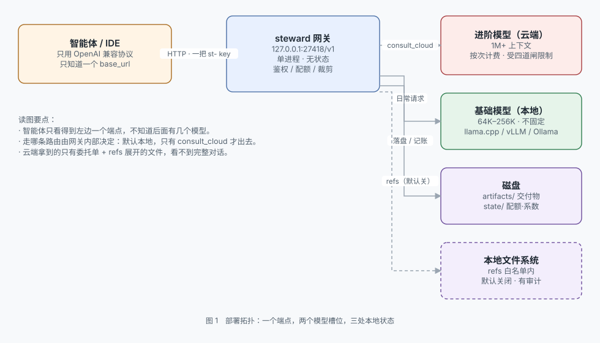
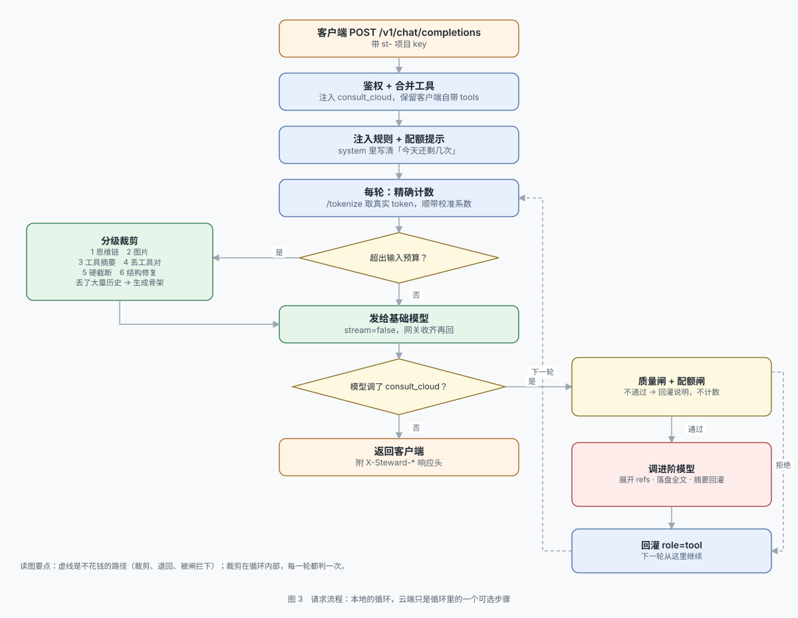

# 架构：本地模型 API 代理

> 项目总览与三张图见仓库根目录的 [`README.md`](README.md)。
> 本文只讲**决策**：为什么是这样，以及被否掉的是什么。

## 形态

一个 OpenAI 兼容端点：`http://127.0.0.1:27418/v1`。任何智能体改 `base_url` 就能接。
**客户端全程不知道进阶模型存在。**

**单进程、单端口、一套计数。** 代码在 `steward/`。



## 两个槽位，不是本地和云端

```
槽位一  基础模型   日常主力，绝大多数请求由它完成    通常：本地 30B MoE
槽位二  进阶模型   只在复杂任务时调用，受配额限制    通常：云端 API
```

刻意不叫 `local` / `cloud`。理由：

1. **分工才是本质。** 基础槽位完全可以填一个便宜的云端模型（比如 deepseek-chat），规则一样成立 —— 它只是"便宜、随便用"的那一侧。
2. **配额只挂在进阶槽位。** 如果按"本地/云端"命名，用户会误以为配额是在拦"出网"，其实它拦的是"花钱"。
3. **换供应商不用改语义。** 哪天把进阶从 A 家换成 B 家，配置里只是换个 `base_url`，模型名一个都不用动。

两个槽位各自需要：`HTTP 地址` + `模型标识` + `API key`。

**基础槽位的 key 可以留空，但不能当成"没意义"。** 本地服务不校验是一回事，部署形态是另一回事：模型一旦在局域网里服务多台设备，或者前面挂了反代、用了 LM Studio / vLLM / llama.cpp 的 `--api-key`，这个 key 就是唯一的门外锁。配置里永远保留该字段，空值表示"不发 Authorization"，非空就发 `Bearer`。

旧配置的 `local:` / `cloud:` 段仍能读，加载时自动映射到 `base:` / `advanced:`。

## 三把钥匙

这个东西的本质是个管家：**背面两把上游 key，正面一把自己的 key**，中间管着账本、窗口和档案。

```
智能体 ──[项目 key: st-xxx]──> steward ──[基础模型 key]──> llama.cpp / LM Studio / vLLM / Ollama
                                  │
                                  └──[进阶模型 key]──> 云端 API
```

| 钥匙 | 谁生成 | 谁持有 | 存哪儿 |
|---|---|---|---|
| 基础模型 key | 模型服务 / 反代 | 只网关 | `.env` 的 `BASE_API_KEY`（可空但保留） |
| 进阶模型 key | 用户买的云 API | 只网关 | `.env` 的 `ADVANCED_API_KEY` |
| 项目 key | 网关自己 | 智能体 | `state/keys.json`，**只存 sha256** |

三条实现约束：

1. **明文不落盘。** 项目 key 只在签发那一刻存在，之后服务端也只能验证、不能重建。丢了就 `key new`。
2. **一个智能体一把 key。** 用量按 key 归因（`/admin/usage` 的 `key` 字段），出事能定位到具体 agent 并单独吊销。
3. **上游 key 永不出网关。** 客户端拿到的响应里没有任何上游端点或凭据信息。

`init` 命令走完这套流程：问基础槽位 → 问进阶槽位 → 写 `config.yaml` → 上游 key 写 `.env` → 签发项目 key 并打印一次 → 顺手 ping 一次基础模型。

## 请求流程



1. 客户端 `POST /v1/chat/completions`，带项目 key
2. 网关注入规则 + 配额提示 + 工具 `consult_cloud`，合并客户端自带 tools
3. 量一遍（优先 `/tokenize` 精确计数），超预算就分级裁剪 + 生成骨架，再转给基础模型
4. 模型直接回答 → 返回
5. 模型调用 `consult_cloud` → **网关拦截，不透传给客户端**
6. 质量闸（委托单够不够格）→ 四道配额闸 → 通过则展开 `refs` → 连同委托单一起发进阶模型；不通过则回一条说明，**不计数**
7. 交付物（或摘要 + 路径）以 `role=tool` 回灌，回到第 3 步
8. 模型不再调工具，或轮次用尽 → 返回

## 为什么是单体，不拆 MCP

原方案是「CCR 做端点 + 自写 MCP server 做 consult_cloud」。拆开有三个硬问题：

| 问题 | 后果 |
|---|---|
| 两处各记一套配额 | 重启、并发、跨进程都会漂移。省钱方案最怕这个 |
| 工具循环跨进程 | MCP 只是被调用的叶子，不知道这是第几轮，做不了轮次上限 |
| 部署三处要改 | 端点、MCP、注入插件，出问题三处查 |

合成一个进程后，判据、计数、循环、截断全在同一个 `asyncio.Lock` 里。

仓库里 `legacy/VENDOR-SURVEY.md` 记录了调研过程，CCR 仍是同类里最强的，但它的 Fusion + MCP 组合正是「拆成两部分」的形态，不符合这个要求。

**从 CCR 照搬的机制**（验证过有效）：虚拟模型名让客户端零改造、规则写进工具 description、服务端工具循环 + 结果回灌。

**没照搬的**：Fusion 的「循环无轮次上限」。对省钱方案这是负资产。

## 上下文治理：本地窗口才是真瓶颈

省钱的另一面是能力受限，而受限最先撞上的不是智力，是**窗口**。

```
进阶模型   1M 输入 / 16K 输出
基础模型   64K / 128K / 256K，各部署不一，--parallel 还会对半切
```

一个跑几小时的编码任务，历史轻松过 15 万 token。这时上游的行为分三种，**只有一种会报错**：

| 上游 | 装不下时 | 客户端能否察觉 |
|---|---|---|
| llama.cpp + `--context-shift` | 从位置 0 开始丢 | 不能，HTTP 200 |
| llama.cpp 默认 | 400 `exceed_context_size_error` | 能，但整轮工具循环白做 |
| Ollama | 从头部截断，只记服务端日志 | 不能，HTTP 200 |

实测这台机器是 `n_keep=0` + context-shift：**最先被丢掉的是 system prompt 和工具定义**。表现不是「答得差」，而是模型忽然不认识 `consult_cloud` 了 —— 看着像模型能力问题，根因在部署参数。

### 四个决定

**一、不猜窗口，去问。** `n_ctx` 不能硬编码：`--parallel 4` 会把窗口切四份，各家暴露位置也不一样。按 `/props`（llama.cpp，能同时拿到 `total_slots`）→ `/v1/models` → `/api/v0/models` → 配置 → 32768 依次探，探到的**每槽**窗口才是真的。探测一次成本可忽略，猜错一次代价是整轮白跑。

**二、不估算，去数。** 字符启发式（中文 0.7、英文 0.28）在散文上够用，在代码和 JSON 上低估 25%–40% —— 而 agent 的上下文主体就是这两样。实测 `"1234567890"` 是 10 个 token，数字一位一个，这是纯字符比例永远抓不住的结构。所以优先调上游 `/tokenize`（32 万字 337ms），数不了才退回估算，再用 `usage.prompt_tokens` 做 EWMA 自校准。

顺带得到一个免费能力：**静默截断检测**。估算说装得下、上游回的 `prompt_tokens` 却明显更小，那就是被截了。这个信号没有别的获取途径。

**三、裁剪要挑时机，因为前缀缓存很贵。** llama.cpp 复用最长公共前缀，改历史中段 = 从改动点重算。实测 prefill 1305 tok/s —— 在 30% 位置改一刀，后面 7 万 token 要重算 54 秒。

所以不做「刚好卡在线上」的连续裁剪，而是**迟滞**：0.85 触发，一次砍到 0.65，且一次至少清 `min_clear_tokens`（8000）。为省两千 token 让缓存全废是负收益。这和 Anthropic 的 `clear_at_least` 是同一个道理：压缩本身有成本，值得压缩才压缩。

同理，**没超预算时一个字节都不动**。裁剪只在超预算时动手，返回新列表，调用方传进来的 `messages` 永不原地修改。

**四、裁剪必须在工具循环内部，不能只在入口。** 这是原实现的一个真实缺陷：入口判一次预算，但交付物和工具结果是在循环中途长出来的 —— 第 4 轮顶上来的 3 万字交付物，入口那次判断根本看不见它。现在每一轮发请求前都过一遍。

### 分级裁剪：按代价从低到高

| 步 | 动什么 | 依据 |
|---|---|---|
| 1 | 历史的 `reasoning_content` | 思维链只在当轮有用，跨轮纯浪费。实测清掉 113 条 |
| 2 | 图片 | 一张图抵 1200 tokens |
| 3 | 旧工具输出 → 头 40 + 尾 40 + 错误/位置行，全文落盘 | 原始日志的边际价值随轮次衰减 |
| 4 | 合并同类工具结果 | 多次 grep 并成一条 |
| 5 | 整组丢最早的 tool_call + tool 结果 | **必须成对**，否则 `tool_call_id` 悬空，上游 400 |
| 6 | 硬截断 | 只在 force（上游已报溢出）时走 |
| 7 | 结构修复 | 删掉没有主人的 tool 消息；摘掉等不到结果的 `tool_calls` |

最后一步是补上去的。第 6 步按位置删、不认配对，可能删掉带 `tool_calls` 的 assistant 却留下它的 tool 结果 —— llama.cpp 能忍，vLLM / 严格 Qwen 模板直接 400。**裁剪的产物必须仍是合法对话**，这是不变量，不是优化。

保护规则也修过一次：原来只保护「最后一条 user」，结果硬截断会把**首条 user（任务目标）** 整句删掉。实测把「把这套服务的配额从按次改成按 token 计量」裁没了，裁剪后第一条 user 变成一段测试输出 —— 模型只能从日志里反推自己要干什么。

裁完往第一条 system 里塞一句 `[网关]` 标记。不标记的话模型会对着断裂的上下文编 —— 它不知道自己少看了一段。

### 溢出自愈

上游真报 400 时，预算这个数已经被证伪，此时按「刚才那份实际没装下的 40%」砍才靠谱，同时永久收缩预算（`budget_scale` × 0.85）并重试一次。省下的是整轮工具循环，也让下一次不再犯同样的错。

### 任务骨架：压完还得记得住

标记只能告诉模型「有缺口」，给不了缺口里的东西。模型于是两种表现都不好：重试已经否决的方案，或者用「根据我们之前的讨论」凭空编。

`spine` 打开后，被丢掉的那片区域交给本地模型提炼成六行，留在第一条 system 里：

```
[网关] 任务骨架（中间 332 条历史已压缩，以下是被保留下来的线索）
goal: 把这套服务的配额从按次改成按 token 计量，并补测试。
constraints: key 格式不能变
facts: prefill 实测 1305 tok/s；单槽 n_ctx=131072
rejected: Redis 计数（运维不批）
current: 已改完 guard.py，测试未跑
next: 补 test_guard.py 的计量用例
```

**`rejected` 和 `facts` 是这两行的全部理由。** 前者丢了会重试已知失败的路径，后者丢了会重新量一遍或改用猜测值。纯机械摘要产不出这两行 —— 得判断哪句是结论、哪句是过程。

三条必须写进代码而不是提示词的约束：

| 约束 | 实现 | 为什么 |
|---|---|---|
| `goal` 只认用户原话 | 网关从裁剪后的消息取第一句 user，塞进提示词并**事后强制覆盖** | 目标句受保护、不在被丢弃区，模型看不到它，就把「最近在干什么」当目标 —— 实测写成「逐个阅读 mod_1 至 mod_43」 |
| 一个请求最多建一次 | `allow_model` 只在 `spine_model_calls < 1` 时为真 | 裁剪多轮丢的是同一段旧历史，为几行几乎一样的字每轮花 7 秒不值 |
| 头尾各取一段 | `render_region` 先给尾部 60% 预算 | 只取开头的话，`current` 会停在几百条消息之前 |
| 注入后重算 `report.after` | 骨架加进 payload 后重新量一遍 | 不重算的话，`observe()` 拿「不含骨架的估算」比「含骨架的实际值」，每次判成低估，系数一路上漂，裁剪点跟着漂 —— **缓存永远命中不了** |

实测：12000 字输入、148–290 tokens 输出、7–13 秒。超时或模型不按格式输出就退回机械骨架（只保 goal 和 current），**绝不阻塞主请求**。

骨架用标记块挂在第一条 system，重复触发时原地替换而不是追加 —— 否则一轮涨一块，很快又回到要裁剪的状态。

### 交付物外置：把窗口不对称变成优势

进阶模型输出 16K 起，回灌进 128K 的窗口，一次吃掉 12%，同一轮问两次就没了。

超过 1500 字的交付物先落盘，回灌的是一份约 500 token 的摘要：id、绝对路径、标题目录、开头 800 字，加一句「需要细节时直接读这个路径，不要凭摘要猜」。**约 500 token 换掉 3 万 token。**

关键不在摘要，在**路径落在智能体自己的文件系统里**。它有读文件工具，要细节时自己去翻。这一步把「本地窗口小」从劣势变成了分工：窗口留给判断，长文留给磁盘。

### 磁盘会一直涨，所以得有回收

存档是只增不减的东西，长期跑必然涨。三件事一起做：

1. **统一抬头。** 每个文件开头是 `kind / turn / created / chars`，人翻得懂，脚本也扫得动。
2. **路径只由日期 + 类型 + 内容 hash 组成。** 轮次只进抬头，不进路径 —— 否则同一份内容在多轮各存一份。按天分桶刚好就是回收的单位。
3. **批量落盘。** 一次裁剪压掉上百条工具输出，逐条落盘写出 113 个文件。合并成一个、指针带行锚点之后是 2 个文件，体积不变。

回收按**目录名里的日期**判断，不按 mtime：mtime 是「最后一次写入」，一个天天在追加的旧目录会永远显得很新，永远删不掉。`max_age_days` 和 `max_total_mb` 取先到者，`clean_interval_s` 节流，`index.jsonl` 有行数上限。

两个实现上的教训：

- 摘要比原文还长时**直接回原文**（短文档 + 长绝对路径就会这样）。存档的意义是省 token，不是走流程。
- 路径给**绝对路径**。相对路径的基准是网关进程的 cwd，而智能体是按自己的 cwd 去 open 的，两者只能碰巧一致 —— 不一致就静默退化成「凭摘要猜」，而这个失败没有任何报错。

### 实测

一台 27B、`n_ctx=131072`、单槽的机器：

```
363 条消息 / 估算 159,239 tokens
  → 裁剪到 68,926，一次 prefill，HTTP 200，62.1s
  → 上游实收 prompt_tokens 61,126（预算 106,803）
  → X-Steward-Ctx: used=68926 budget=106803 saved=90313
```

裁剪报告：`{"before":159239,"after":68926,"saved":90313,"stripped_reasoning":113,"digested":112,"dropped":170,"hard_cut":0}` —— 一次砍掉 57%，没走到硬截断。

## refs：把窗口不对称变成优势的另一半

交付物外置解决"出"，refs 解决"进"。

委托单终究是转述。"我在 refresh_token 里加了锁但并发还是漏"，读到这句话的人能猜十个方向；读到那 80 行代码的人只有一个答案。**20 个字符的引用换来 12K 真实源码，而且这份源码只进云端那 1M 的窗口，一分都不占本地。**

所以 refs 同时是能力和风险：

```
进阶模型窗口 1M  ── 装得下整份源码 ──> 结论确定
本地窗口 128K    ── 一个字都不用装 ──> 预算不变
```

这不是"减少传输"，是**换了个地方算**。也是整个方案里唯一一处真正利用了"两边窗口不一样"的地方 —— 其余部分（裁剪、计数）都只是在忍受它。

实测一次真实委托（27B，本地与进阶指向同一台机器，便于看清 token 流向）：

```
refs 展开  文件=1 字数=13610
进阶模型返回  kind=review 19631ms  tokens=4404/756
X-Steward-Ctx: used=1962 budget=106803
```

同一个请求，进阶侧吃到 4,404 tokens 源码，本地侧只占 1,962。这个比例（约 2.2 : 1）随引用的文件数线性放大 —— 而本地的 1,962 几乎不随引用变化。

### 安全边界写在网关里，不在提示词里

| 约束 | 实现 |
|---|---|
| 默认关闭 | `refs.enabled: false`；开了没配 `roots` 直接拒绝启动 |
| 白名单 | `resolve()` 之后判归属 |
| 符号链接 | 靠上一条兜住 —— 链接先展平，再判落在哪个根里面 |
| 黑名单 | 25 条：`.env` / `*.pem` / `*.key` / `id_rsa*` / `*credential*` / `*secret*` / `.git/*` … |
| 二进制 | 首 8KB 含 NUL 拒绝 |
| 限额 | 单文件 64KB、单次 12 万字符、最多 20 个文件 |
| 审计 | 每次展开一行 `state/refs.jsonl` |

**符号链接那条是这类功能最常见的洞。** 在字符串上找 `..` 挡不住 `link -> /etc/passwd`：路径看起来干干净净，读出来是别人家的文件。正确做法是先 `resolve()` 把链接展平，再判落点是否在白名单内 —— 一条判断同时覆盖 `../..` 和软链逃逸。

黑名单故意不含 `*token*`：会误伤 `tokenizer.py`。安全规则宽到影响正常使用，用户就会整体关掉它，那才是真的不安全。

### 引用失败必须说出来

被拒的文件不静默消失，回灌的 `role=tool` 消息前面加一行 `[refs] 已附上 N 个文件…未附：<原因>`。

理由和裁剪标记一样：**模型的错误前提比信息缺失更危险**。它以为八个文件都给了，就会按"进阶模型看过全部"推理，然后给出一个自信的错答案。`glob` 命中超限时同样明说"只取了前 N 个"。

### 可审计性靠一条命令

```bash
python -m steward refs src/auth/session.py .env /etc/passwd
```

逐条打印允许/拒绝与原因，有拒绝则退出码非 0。白名单这种东西最怕"以为配了其实没生效"，判决得能一句话问出来，而不是去读代码。

## 关键设计决策

### 规则写进工具描述，不写进 system prompt

模型在 function calling 时重点读 `description`，而 system prompt 每轮都占 token。

- system prompt 只留一句定位：`把它当外部专家：给你的是没想过的角度，不是你不愿意写的代码。`
- 触发判据与禁令塞进 `description`；BRIEF 的五行格式放在 `brief` 参数自己的说明里 —— 那里离填写点最近
- **每件事只说一遍。** 五行格式、一次一问、四段式输出，各自只出现在一个位置

改规则只改 `prompt.tool_description`，不动代码。

**注入成本是净增加，所以设了上限。** 这套网关包在智能体自己的提示词外面，每一分注入都是额外的：

| 组成 | 精简后 | 精简前 |
|---|---|---|
| system 定位 | 21 tok | 53 tok |
| 配额提示 | 12 tok | 32 tok |
| 工具定义 | 498 tok | 719 tok |
| **合计（每轮）** | **531 tok** | **804 tok** |

砍掉的都是重复和元话语，判据一条没少：system 里的「只出方案/不执行操作」与 description 首段重复；五行格式在 description 和 `brief` 参数里各写了一遍；「四条里第 3 条是硬性的……第 1、2、4 条是提醒」这种解释自己结构的元话语，模型读判据本身就够了。`tests/test_prompts.py` 里有硬上限断言，提示词只能变短，不能悄悄长回去。

同时修了一处指代歧义：配额提示原本写「按上面四条判断」，但它在 system 里，**上面什么都没有**。现在只报数字，不复述判据。

**判据必须是客观可判的。** 最初写的是「只有任务确实复杂、且本地尝试后仍拿不准时才用」——「复杂」是主观词，模型没法据此决策，最后变成凭感觉调用。现在换成四个它真能回答的问题：

1. **我掌握的前提是否足够下判断？** 不够就先去查，别拿半截信息去问。
2. **我能不能当场写出带失败判据的执行步骤？** 能就自己写。
3. **这一步做错的代价是否不可逆？** 数据迁移、批量删除、线上变更、schema 变更 —— 这类**必须**问，哪怕有把握。
4. **我是否已经实际试过并失败？** 没试过先试。

同时删掉了一条模型不可能诚实回答的禁令：「你本来就知道答案只是需要打字」。改成可判定的：「如果你能在不查资料的情况下写出完整执行步骤，就不要问」。

### 委托质量闸：烂 brief 比不调用更糟

一份烂 brief 换来一份错方案，模型会把错方案当真执行，而额度已经花了。所以进配额闸之前先过一道检查，不通过就退回让模型补，**不计数、不花钱**：

| 退回条件 | 为什么 |
|---|---|
| `ask` 为空或超过 400 字 | 一次问多个问题，答案会全是浅的 |
| 用了五行格式但 `goal` 为空 | 专家不知道你要干什么 |
| `diagnosis` / `review` 的 `tried` 为空或写 none | 没有实际执行记录，专家只能猜 |
| 完全没按格式写、内容又少于 40 字 | 九个字的委托单换不回有用的方案 |

尺度刻意放宽：**格式不规范但内容够的放行**。云端读散文也能干活，多退一轮纯属浪费本地时间。同一请求最多退两次，第三次放行 —— 否则模型会在原地打转，比错一次更糟。

配额本身也要让模型看见。`remaining_today` 只出现在被拒提示里太晚了，那一轮已经浪费。每轮把它写进 system：`[配额] 本轮最多 2 次，今日还剩 3 次（偏紧）。` 模型知道剩得少，才会把问题攒成一个更值钱的问。

### 配额：四道闸，只拦进阶槽位

| 闸 | 参数 | 默认 | 拦什么 |
|---|---|---|---|
| 单请求 | `max_calls_per_turn` | 2 | 一次请求内反复外援 |
| 每日 | `daily_limit` | 5 | 一天总量 |
| 间隔 | `min_interval_s` | 30 | 抖动式连续调用 |
| 重复 | `dedupe` / `similarity` | 开 / 0.92 | 换说法问同一个问题 |

**"一轮"= 一次 `/v1/chat/completions` 请求内部的循环。**
agent 干一个任务会发很多次请求，所以单请求上限挡不住总量，`daily_limit` 才是最终防线。

计数在**放行时** +1，不等返回，防并发绕过。连接失败自动退回。配额落盘，重启不清零。

### 被拦时不报错

回一条 `role=tool` 消息：「已达上限，不要重试，用已有交付物继续」。
模型照做，agent 不崩。响应头暴露实况：`X-Steward-Calls` / `-Denied` / `-Remaining` / `-Rounds`。

### 强制收尾

`max_tool_rounds`（默认 4）用尽后，把收尾指令**并进第一条 system**，并且这一次不传 tools。防止模型卡在「还想再问一次」。

不用「在末尾追加一条 system」的写法：末尾 system 处在 tool 结果之后，不合多数 chat template 的预期，而且它会让模型把「总结」当成又一轮对话的开场。并进头部会让前缀缓存全废，但这已经是最后一轮，缓存本来也用不上了 —— 拿一次全额 prefill 换指令被正确执行，是划算的。

## 上游适配：不假设只有 Ollama

本地部署的形态比"Ollama 一种"多得多，网关按 OpenAI 兼容协议统一处理，差异只体现在三处：

| 差异 | 处理 |
|---|---|
| **协议** | `protocol: chat`（`/v1/chat/completions`）或 `responses`（`/v1/responses`）。对外始终是 chat，内部翻译 |
| **模型标识** | 直接透传。llama.cpp 就是 GGUF 路径，Ollama 是 `qwen3:30b`，不假设格式 |
| **推理型模型** | `thinking: off` → 发 `chat_template_kwargs.enable_thinking=false` |

`thinking` 这条是实测出来的硬需求。同一个 27B，400 token 预算下：

- 开着 thinking：1747 字思维链，预算耗尽，**一次工具调用都没有**，返回空
- 关掉 thinking：9 秒，**工具调用正常**

路由判断要的是"该不该花钱"，不需要长篇推理；深度思考属于进阶槽位。

**上游探测**（`steward test`）读 `/v1/models` 拿模型列表和 `owned_by`，对 llama.cpp 再读 `/props` 拿上下文和槽位数。只读，不产生推理开销。

## 上游 keep-alive 缺陷的自愈

真实设备上复现过：同一连接上交替返回 200/404/200/404，换新连接全 200。这是上游的 bug，不是请求体的问题（同样的 body 用新连接发就是 200）。

网关的处理：遇到 404 且 `retry_404` 开着，就**丢掉连接池、切短连接重试一次**，并把短连接模式保持下去，后续不再复发。只对 404 生效，不会掩盖真正的地址填错 —— 那种情况重试仍然 404，错误原样抛出。

## 空回复的兜底

推理型模型把 `max_tokens` 全花在思维链上时，会返回 `finish_reason=length` + 空内容 + 无工具调用。这一轮完全白花。

网关检测到这个组合就**把预算翻倍重试一次**（上限 `base.max_tokens`），仍为空才把控制权交回模型。同时 `min_max_tokens`（默认 1024）会在客户端给的预算过小时先抬一脚。

## 三个技术坑

**1. 流式的两难。** 流到一半冒出 tool_call，已吐的 token 收不回来。
解法：网关内部非流式跑完循环，最后一段用 SSE 吐出。首字延迟 = 整轮耗时，换来不会「答案吐一半重来」。

**2. 工具数组冲突。** 客户端自带 tools 要和注入的合并：
```python
tools = client_tools + [consult_cloud]
```
回灌后只摘 `consult_cloud` 的 tool_call，客户端的原样透传。若模型同时调两类，先执行咨询，再把剩余 tool_call 返回给客户端。

**3. tool_call_id 必须对齐。** `role=tool` 消息的 id 要和模型产出的完全一致，否则上游 400。

## 进阶槽位空着时

只看 `base_url` 和 `model` 两项，缺一项就按空槽位处理。

**空槽位是合法配置，不是配置错误。** 一开始把它写成致命错误，结果是「只有本地模型」的人根本起不来——而那是最常见的用法。现在它降级为警告，代价是：

- 不注入 `consult_cloud`。工具定义约 500 tokens，是每轮常驻开销；给模型一个「永远会被拒绝」的工具比不给更糟，它会反复尝试并浪费轮次。
- `/health` 里 `advanced.configured=false`，`serve --check` 里显示「进阶=空槽位」。

**key 为空是合法的** —— 进阶槽位也可能指向本地端点。填错导致的 401/403 会记一次失败，但上游 4xx 没有消耗 token，配额自动退回。

这条改动的意义不在功能，在**错误分类**：原来 `validate()` 把「基础模型缺失」和「进阶槽位空着」放在同一个列表里，前者致命、后者可选，却共用一句「服务仍会启动」。用户看到警告无法判断自己到底能不能跑。现在拆成 `validate()`（致命）和 `warnings()`（可选），启动流程按两套处置。

## 结论

一个进程解决全部问题，代价是要维护约 5600 行 Python（含注释和空行；其中 180 行是密钥层，200 行是协议互转，970 行是上下文治理，410 行是骨架，400 行是存档，430 行是 refs —— 后四块最重，也最容易被低估）。

换来的是一套能被人审计、能被一句话说清楚的配额逻辑，一把随时能吊销的对外 key，一个不会在长任务第 40 轮忽然"变笨"的基础模型，一条默认关着、开了也知道自己开了什么的文件通道，以及一个不会无限涨的磁盘。
