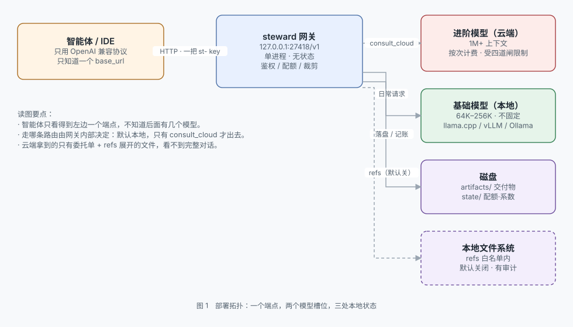
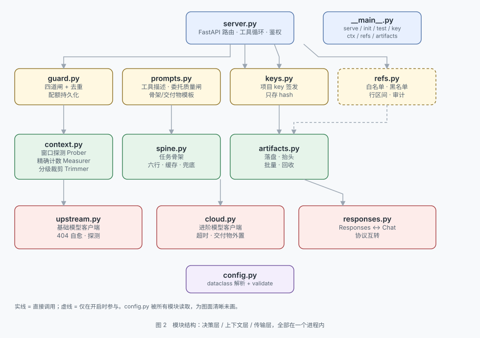
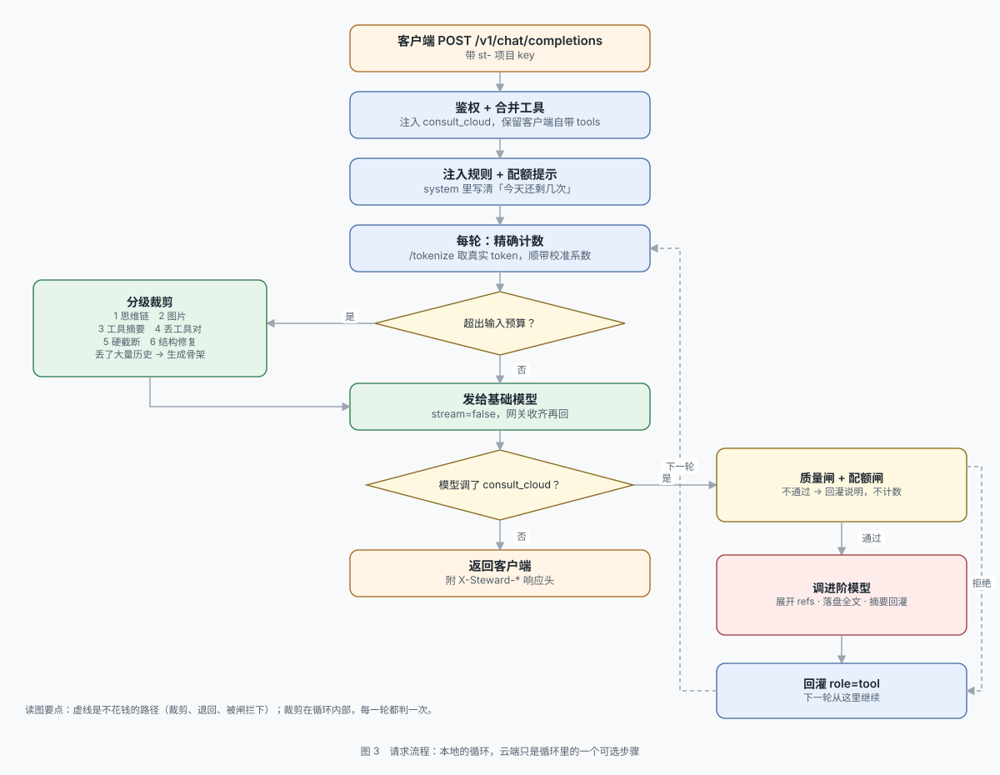

# steward


[简体中文](README.md) | **English**

[](LICENSE)
[](https://www.python.org/)
[](tests)
[](https://github.com/liuda1999/steward/releases)

> **Token-cost governance for local AI agents (a local-first LLM gateway).**
> One **OpenAI-compatible** endpoint, two model slots: local by default, cloud on demand.
> A day of group-chat chatter cost CNY 40–50; about 80% of it could have run locally.

I ran one of those "big fat fish" agents — DSH wired into a group chat with a persona. It worked, and the bill was real: **CNY 40–50 a day**.

The money did not go to answers. It went to the system prompt, tool definitions and full history resent on every single turn. Most of that work — file wrangling, small talk, reformatting, repeated confirmations — a local model can do perfectly well.

steward intercepts it: **local by default, cloud only when the model asks and the gateway approves.** At that ratio the bill lands near one fifth.
> **Open <http://127.0.0.1:27418/> for the console** — fill the slots, tune quotas, issue keys, never touch the command line.

```
agent ──OpenAI-compatible──▶ 127.0.0.1:27418/v1 ──┬── local model (default)
                                                  └── cloud model (only on request)
```

| | |
|---|---|
| Version | **v1.6.3** ([release notes](docs/releases/v1.6.3.md)) |
| Protocol | `/v1/chat/completions` + `/v1/responses`, OpenAI-compatible |
| Upstream | any OpenAI-compatible endpoint: llama.cpp / vLLM / LM Studio / Ollama / a cloud API |
| Shape | single-process FastAPI, no database; web console on the same port |
| Default port | 27418 |
| License | **Apache-2.0** — commercial use, modification, closed-source distribution, with a patent grant |

**The name means "steward".** It does not decide what you do; it keeps three things: the books (can you afford this call), the window (does it still fit), the archive (does it survive on disk).

---

## Quick start (the one command you run every day)

You do not need to read the architecture first. Three steps:

```bash
git clone https://github.com/liuda1999/steward.git
cd steward
./scripts/start.sh          # Linux / macOS
```

```bat
REM Windows (cmd or PowerShell, from the repo root)
scripts\start.bat
```

The first run checks the environment, generates `config.yaml`, starts the gateway, and prints the console URL with a one-time token:

```
  console http://127.0.0.1:27418/
  token   xxxxxxxxxxxxxxxx
```

**Every later start is the same command** (`./scripts/start.sh` or `scripts\start.bat`). `config.yaml` already exists and is never overwritten.

No script? From the repo root:

```bash
python3 -m steward start    # check env -> prepare config -> start (use this first)
python3 -m steward serve    # config already in place: start directly
python3 -m steward --help   # list every subcommand
```

> Once it is up, open <http://127.0.0.1:27418/> for the console. The gateway and console start fine even when the model endpoint is down — only `/v1` calls will fail.

---

## 1. What it solves

Running a local model as the daily driver with the cloud as backup is easy to state and hard to run. Four things get in the way:

| Problem | What steward does |
|---|---|
| When is spending worth it? | It does not judge difficulty for the model. It exposes a `consult_cloud` tool the model may call, and **counts whether that call is affordable** |
| The local window is too small? | Probes the real window at startup (honouring `--parallel` splitting), counts exactly, trims in tiers, and summarises large drops into a six-line task spine |
| Cloud output eats the window? | Deliverables over 1,500 chars are written to disk; only a ~500-token summary and the file path go back into history |
| The disk fills up over months? | Deliverables are archived by type and content hash, and reclaimed by dated directory |

The dangerous part of overflow is that **it does not raise an error**: llama.cpp with `--context-shift` drops from position 0, so the system prompt and tool definitions die first; Ollama truncates from the head and only writes a server-side log; both return HTTP 200. The window has to be accounted for by the gateway, because the upstream will not tell you.

Window size has no tiers: `context.ctx_limit` is any integer (100000 or 1048576 both work). 64K / 128K / 256K are common examples, **not tiers**; the real value is probed at startup by default.

---

## 2. Architecture

### 2.1 Deployment topology



- The agent sees one endpoint and one `st-` key. It does not know how many models sit behind it.
- Local is the default. Traffic leaves the machine only when the model calls `consult_cloud`, and the cloud sees just the brief plus `refs`-expanded files — **never the full history**.

### 2.2 Module structure



| Layer | Modules | Responsibility |
|---|---|---|
| Decision | `guard` / `prompts` / `keys` / `refs` | whether to allow, whether the brief qualifies, whose key this is, whether a file may leave |
| Context | `context` / `spine` / `artifacts` | measure the window, trim, keep a spine, archive and reclaim |
| Transport | `upstream` / `cloud` / `responses` | two upstream clients plus protocol conversion |

### 2.3 Request flow



- Trimming runs **inside the tool loop**, every round — deliverables and tool results grow mid-loop, and checking only at entry lets the window blow up later.
- The cloud call is one optional step in that loop. If the model does not call it, the turn simply ends.

---

## 3. Deploy

**Requires Python 3.11+.** No database, no external services.

```bash
git clone https://github.com/liuda1999/steward.git
cd steward
./scripts/start.sh          # Linux / macOS
```

```bat
REM Windows
scripts\start.bat
```

It checks the environment, generates a config, starts the gateway, and prints the console URL with a one-time token:

```
  [1/4] Python 3.13.14  OK
  [2/4] dependencies  OK
  [3/4] first run, config generated: /path/to/steward/config.yaml
  [4/4] config valid  OK

  endpoint http://127.0.0.1:27418/v1
  console  http://127.0.0.1:27418/
  token    xxxxxxxxxxxxxxxx
```

The first run writes `config.yaml` into the current directory from the bundled template, so a fresh clone needs no manual config step.

### 3.1 First-time configuration

Open <http://127.0.0.1:27418/>, paste the token, fill the two slots, and hit "save and restart". Each slot has a "test connection" button that reads the upstream `/v1/models` and lists the real model names — click one to fill it in.

If it will not open: check the port printed in the startup banner (it is not 27418 once you change `server.port` or pass `--port`). If the port is confirmed listening but the page keeps spinning, a browser proxy is probably intercepting localhost — see troubleshooting 6.3 in [DEPLOYMENT](docs/DEPLOYMENT.md).

Prefer the CLI:

```bash
python3 -m steward init            # interactive wizard
python3 -m steward serve --check   # validate the config without starting
```

Install it as a global command (optional):

```bash
pip install -e .
steward start
```

### 3.2 Connect a client

```python
base_url = "http://127.0.0.1:27418/v1"
api_key  = "st-..."        # shown once at issue time; only the hash is stored
```

**A lost key can only be reissued** — the gateway stores a sha256 and cannot recover it. The console's *project key* panel issues and revokes them, with the same one-time display.

### 3.3 LAN, autostart, upgrades

See **[docs/DEPLOYMENT.md](docs/DEPLOYMENT.md)**: sharing on a LAN, systemd / Task Scheduler, reverse proxy, upgrade and rollback, troubleshooting.

---

## 4. Using it

### 4.1 Console

Same port: `/` is the console, `/v1/*` is the API. They do not interfere. The console is **bilingual**: the language toggle in the header switches instantly, and the choice is remembered in the browser.

| Panel | What you can change |
|---|---|
| Base / advanced slot | URL, model name, upstream key, protocol, thinking — each with "test connection" |
| Quota | per-request cap, daily total, minimum interval |
| Context | window ceiling, trim water level, spine toggle |
| Archive / refs | retention days, size cap, outbound toggle and allowlist |
| Listener / project keys | host and port; issue and revoke keys |

The token is printed at startup and stored in `state/console.token`. Saving rewrites values line by line (**comments survive**), puts secrets in `.env` (the YAML keeps `${BASE_API_KEY}`), and runs `validate()` before writing. Changes take effect after a restart; the console offers "save and restart".

### 4.2 Two slots — one is enough

| Configuration | Result |
|---|---|
| Both filled | Full capability: day-to-day on `base`, hard problems on `advanced` after the model asks |
| Only `base` | **Valid.** Local-only mode; `consult_cloud` is not injected, saving ~500 tokens per turn |
| Only `advanced` | Will not start — with no base model there is nothing to serve |

An empty slot is deliberately legal: "I only have one local model" is the common case.

**The two slots are equals, and `base` does not have to be a vendor's official model.** Put an uncensored or abliterated local model there and everyday conversation never leaves the machine — no egress, no per-token bill — while the cloud is used only when deep reasoning is genuinely needed, at the model's request and with the gateway's approval. The gateway does not filter content or make compliance decisions for you: which model you run, and what you are responsible for, is up to the operator.

### 4.3 Model identifiers

**A model identifier is the exact string the upstream recognises.** The gateway forwards it verbatim; a typo earns you the upstream's 400.

| You want | Fill in |
|---|---|
| DeepSeek Flash / regular chat | `deepseek-chat` |
| DeepSeek Pro / deep reasoning | `deepseek-reasoner` |

**The reasoning variant is a different model name, not a switch.** `thinking: on/off` sends `chat_template_kwargs.enable_thinking`, which only local servers (llama.cpp / vLLM / Qwen) understand; cloud APIs do not. Whether you get reasoning depends on which model name you pick.

When unsure, ask the upstream: the console's "test connection" lists the real names from `/v1/models`.

### 4.4 Common commands

| Command | Purpose |
|---|---|
| `steward start` | check environment → prepare config → serve |
| `steward serve` | serve directly (`--port` overrides temporarily) |
| `steward init` | interactive setup of both slots plus a first key |
| `steward test` | connectivity of both slots |
| `steward ctx` | real window / input budget / counting method |
| `steward key new` / `list` / `revoke` | issue / list / revoke project keys |
| `steward artifacts` | archive usage, `--clean` to reclaim |

Without the global command, replace `steward` with `python3 -m steward`.

---

## 5. Configuration

Every option is documented in [`steward/config.example.yaml`](steward/config.example.yaml) — the file `config.yaml` is generated from on first run.

```yaml
base:                       # daily driver, any OpenAI-compatible endpoint
  base_url: http://127.0.0.1:8080/v1
  model: qwen3-30b
  thinking: "off"           # turn off for local reasoning models, or tool calls stall
  timeout_s: 600            # local long-context first token is slow

advanced:                   # the specialist, used only for consult_cloud; may be empty
  base_url: https://api.deepseek.com/v1
  model: deepseek-chat
  timeout_s: 120            # typical cloud ceiling

guard:
  max_calls_per_turn: 2     # cloud calls allowed per request
  daily_limit: 5            # daily total, the last line of defence
  min_interval_s: 30

context:
  ctx_limit: 0              # 0 = auto-probe; any integer also works
  target_ratio: 0.65        # trim to 65% of budget, leaving room to avoid re-trimming
  spine: true               # produce a six-line spine when trimming is deep

artifacts:
  max_age_days: 30
  max_total_mb: 512

refs:                       # lets the cloud read local files; the only outbound channel
  enabled: false
  roots: []                 # enabled with an empty allowlist refuses to start
```

**`refs` is off by default on purpose.** It is the only channel that sends local content out: root allowlist, 64 KB per file, 120k chars per call, one audit line per expansion. Confirm `roots` before enabling it.

---

## 6. Documentation

| Document | Contents |
|---|---|
| [`docs/DEPLOYMENT.md`](docs/DEPLOYMENT.md) | Deployment and startup: LAN, autostart, upgrades, troubleshooting |
| [`steward/README.md`](steward/README.md) | Implementation details, every parameter, troubleshooting table (Chinese) |
| [`ARCHITECTURE.md`](ARCHITECTURE.md) | Architectural decisions and the alternatives that lost (Chinese) |
| [`CONTEXT-DESIGN.md`](CONTEXT-DESIGN.md) | The full context-governance argument and measurements (Chinese) |
| [`HANDOFF-PROTOCOL.md`](HANDOFF-PROTOCOL.md) | Brief and deliverable format definitions (Chinese) |
| [Releases](https://github.com/liuda1999/steward/releases) | What changed in each version |

---

## 7. License

This project is licensed under the **Apache License 2.0**. Full text in [LICENSE](LICENSE); copyright and third-party notes in [NOTICE](NOTICE).

**You may:**

| | |
|---|---|
| Commercial use | Yes — free, no notification required |
| Modify | Yes — you do not have to publish your changes |
| Distribute | Yes — including closed-source distribution and embedding in commercial products |
| Private deployment | Yes — unlimited machines |
| Patents | Contributors grant you a licence to the patents necessarily practised by this project |

**You must:**

- Keep [LICENSE](LICENSE) and [NOTICE](NOTICE)
- State that modified files were changed
- Not use the project name or the author's name to endorse your derivative — trademark is not covered by the grant

**You should know:**

- The software is provided "as is", without warranties or conditions of any kind, and the author is not liable for the consequences of its use.
- The patent grant is reciprocal: if you sue over this project's patents, the grant terminates.

Source files start with `SPDX-License-Identifier: Apache-2.0` so tooling can detect the licence automatically.
