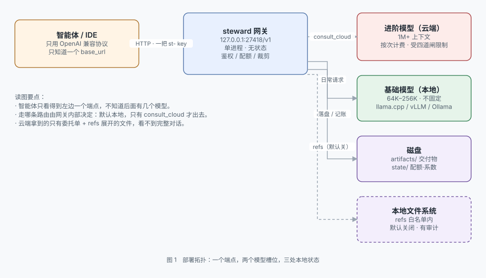
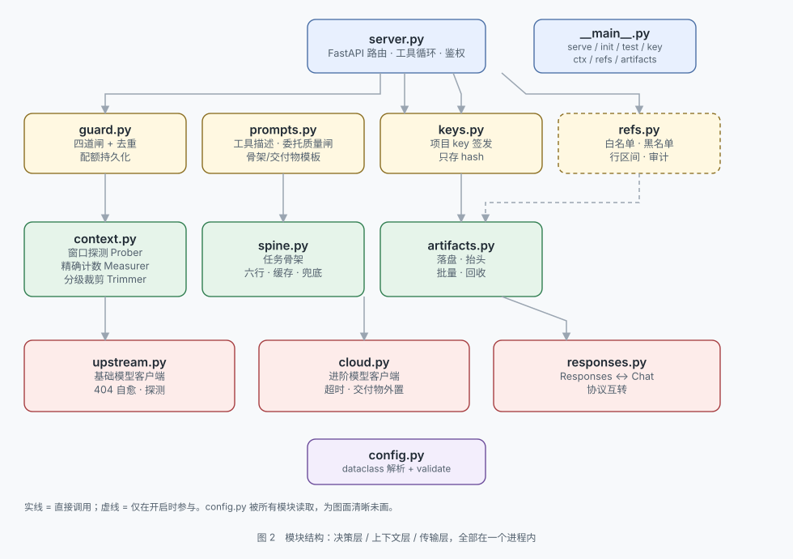
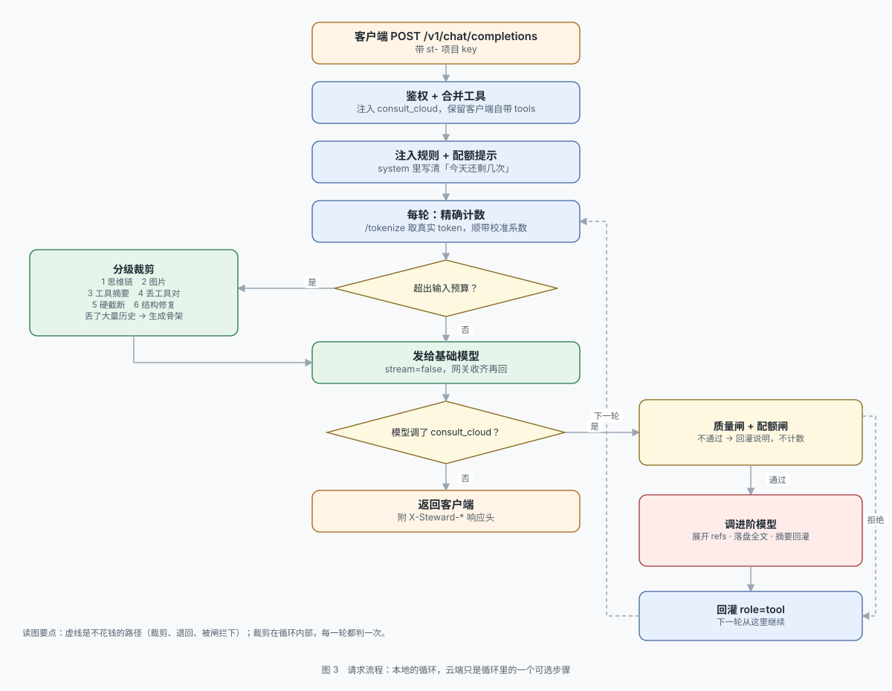

# steward


**简体中文** | [English](README.en.md)

[](LICENSE)
[](https://www.python.org/)
[](tests)
[](https://github.com/liuda1999/steward/releases)

> **本地推理与云端混用的 LLM 网关（local-first LLM gateway），大幅降低云端 API 开销。**
> 一个 **OpenAI-compatible** 端点、两个模型槽位：日常请求走本地，云端只在真正需要时出场。
> 下游只看到同一个接口、同一把 key —— 不需要知道背后是本地还是云端。

举个最直观的例子。我养过一只「大肥鱼」—— DSH 跑起来、接进社交群、写好人设。它很能干，账单也很实在：**一天四五十块**。

翻开销才看清：钱不是花在「回答」上，是花在**每一轮都要重发的 system prompt、工具定义和整段历史**上。而其中大部分——整理文件、简单寒暄、格式转换、重复确认——本地模型完全做得来。

steward 就把这块拦下来：**默认走本地，云端只在模型主动申请、且网关核准后才出场**。按这个比例跑，成本大约是原来的两成。
> **浏览器打开 <http://127.0.0.1:27418/> 就是控制台** —— 填槽位、改配额、签发 key，不用碰命令行。

```
智能体 ──OpenAI 兼容──▶ 127.0.0.1:27418/v1 ──┬── 本地模型（默认）
                                            └── 云端模型（仅当模型主动申请）
```

| | |
|---|---|
| 版本 | **v1.6.5**（[发布说明](docs/releases/v1.6.5.md)） |
| 协议 | 对外只提供 `/v1/chat/completions`（OpenAI 兼容）；上游槽位可选 chat 或 responses |
| 上游 | 任意 OpenAI 兼容端点：llama.cpp / vLLM / LM Studio / Ollama / 云 API |
| 形态 | 单进程 FastAPI，无数据库；同一端口带 Web 控制台 |
| 默认端口 | 27418 |
| 许可证 | **Apache-2.0** —— 可商用、可修改、可闭源分发，含专利授权 |

**名字取自「管家」。** 它不替你决定做什么，只管三件事：账本（花不花得起）、窗口（装不装得下）、档案（存不存得住）。

---

## 快速启动（日常就这一条命令）

不用先读架构，三步就能跑起来：

```bash
git clone https://github.com/liuda1999/steward.git
cd steward
./scripts/start.sh          # Linux / macOS
```

```bat
REM Windows（在项目根目录的 cmd 或 PowerShell 里）
scripts\start.bat
```

首次运行会自动检查环境、生成 `config.yaml`、启动服务，并打印控制台地址和一次性口令：

```
  控制台 http://127.0.0.1:27418/
  口令   xxxxxxxxxxxxxxxx
```

**之后每次启动都是同一条命令**（`./scripts/start.sh` 或 `scripts\start.bat`）。`config.yaml` 已经在了，不会覆盖你的配置。

不想用脚本，在项目根目录直接：

```bash
python3 -m steward start    # 检查环境 → 备配置 → 起服务（新手用这条）
python3 -m steward serve    # 配置已就绪时，直接起
python3 -m steward --help   # 看全部子命令
```

> 服务起来后，浏览器打开 <http://127.0.0.1:27418/> 就是控制台。模型端点即使没开，服务和控制台也能正常启动 —— 只是 `/v1` 对话会失败。

---

## 一、它解决什么问题

把本地模型当日常主力、云端当外援，难的不是接通，是下面四件事：

| 问题 | 做法 |
|---|---|
| 什么时候该花钱？ | 不替模型判断难易，而是给它一个 `consult_cloud` 工具让它自己申请；**能不能花由网关数着** |
| 本地窗口装不下？ | 启动时探测真实窗口（含 `--parallel` 切分），精确计数，分级裁剪，裁掉大段时生成六行任务骨架 |
| 云端输出吃掉窗口？ | 超过 1500 字的交付物先落盘，只回灌约 500 tokens 的摘要 + 文件路径 |
| 跑几个月磁盘满了？ | 交付物按类型与内容 hash 存档，按日期目录回收 |

超窗最危险的地方在于**它不报错**：llama.cpp 开 `--context-shift` 会从位置 0 开始丢，system prompt 和工具定义最先阵亡；Ollama 从头截断只写服务端日志；两者都返回 HTTP 200。所以窗口必须由网关自己记账，不能指望上游报错。

窗口大小没有档位：`context.ctx_limit` 是任意整数（100000、1048576 都行），64K / 128K / 256K 只是常见举例，**不是档位**；默认在启动时自动探测真实值。

---

## 二、架构

### 2.1 部署拓扑



- 智能体只看到一个端点、一把 `st-` 开头的 key，不知道后面有几个模型。
- 默认走本地；只有模型主动调用 `consult_cloud` 才出网。云端只收到委托单和 `refs` 展开的文件，**看不到完整对话历史**。

### 2.2 模块结构



| 层 | 模块 | 职责 |
|---|---|---|
| 决策 | `guard` / `prompts` / `keys` / `refs` | 该不该放行、委托够不够格、这把 key 是谁、这个文件能不能发 |
| 上下文 | `context` / `spine` / `artifacts` | 量窗口、裁剪、留骨架、落盘回收 |
| 传输 | `upstream` / `cloud` / `responses` | 两个上游客户端 + 协议互转 |

### 2.3 请求流程



- 裁剪在**工具循环内部**每轮判一次 —— 交付物和工具结果是在循环中途长出来的，只在入口判一次会被顶爆。
- 云端调用只是循环里的可选一步；模型不调用，这一轮就结束了。

---

## 三、部署

**要求：Python 3.11+。** 无数据库、无外部服务。

```bash
git clone https://github.com/liuda1999/steward.git
cd steward
./scripts/start.sh          # Linux / macOS
```

```bat
REM Windows
scripts\start.bat
```

它会检查环境、生成配置、启动服务，并打印控制台地址和一次性口令：

```
  [1/4] Python 3.13.14  OK
  [2/4] 依赖齐全  OK
  [3/4] 首次启动，已生成配置：/path/to/steward/config.yaml
  [4/4] 配置校验通过  OK

  端点 http://127.0.0.1:27418/v1
  控制台 http://127.0.0.1:27418/
  口令   xxxxxxxxxxxxxxxx
```

首次启动会在当前目录生成 `config.yaml`（内容来自随包模板），所以 `git clone` 之后不需要先建配置文件。

### 3.1 首次配置

打开 <http://127.0.0.1:27418/>，输入口令，填两个槽位，点「保存并重启」。每个槽位都有「测试连接」，会读上游的 `/v1/models` 并列出真实模型名，点一下即可填入。

打不开的话：先看启动横幅里的实际端口（改过 `server.port` 或用过 `--port` 就不是 27418 了）。端口的进程确认在跑、浏览器却一直转圈，那多半是本机请求被代理接走了，见 [DEPLOYMENT 6.3](docs/DEPLOYMENT.md)。

不想用界面也行：

```bash
python3 -m steward init            # 交互式向导，一次配完
python3 -m steward serve --check   # 只校验配置，不启动
```

装成全局命令（可选）：

```bash
pip install -e .
steward start
```

### 3.2 接入客户端

```python
base_url = "http://127.0.0.1:27418/v1"
api_key  = "st-..."        # 签发时只显示一次，之后只存 hash
```

> **base_url 必须带 `/v1`。** 如果客户端去请求 `/models`、`/responses`（没有 `/v1` 前缀），说明它把根地址当成了 base_url，只会拿到 404。
>
> **对外只有 Chat Completions。** `responses` 是**上游槽位**的可选协议，不是对外端点；只会说 `/v1/responses` 的客户端连不上这个网关。

**key 丢了只能重新签发** —— 网关只存 sha256，找不回来。控制台「项目 key」可以签发、吊销，也可以对某一把点「重新签发」（吊销旧的、换一把新的，标签沿用）；签发结果带一键复制，但明文只出现这一次。

### 3.3 局域网、开机自启、升级

见 **[docs/DEPLOYMENT.md](docs/DEPLOYMENT.md)**：局域网共享、systemd / 计划任务、反向代理、升级回滚、排错对照表。

---

## 四、使用

### 4.1 控制台

同一个端口：`/` 是控制台，`/v1/*` 是 API，互不干扰。界面**中英双语**，右上角的 `EN` / `中文` 一键切换，选择记在浏览器本地。

| 位置 | 能改什么 |
|---|---|
| 基础 / 进阶槽位 | 地址、模型名、上游 key、协议、thinking；带「测试连接」 |
| 配额 | 单请求上限、每日总量、最小间隔 |
| 上下文 | 窗口上限、裁剪水位、骨架开关 |
| 存档 / refs | 保留天数、容量上限、外发开关与白名单 |
| 监听 / 项目 key | 地址与端口；签发、吊销 key |

口令在启动横幅里，也存在 `state/console.token`。保存时按行改值（**注释原样保留**）、密钥写进 `.env`（YAML 里只留 `${BASE_API_KEY}` 占位）、先跑 `validate()` 再落盘。改完需要重启生效，界面提供「保存并重启」。

### 4.2 两个槽位，可以只填一个

| 配置 | 结果 |
|---|---|
| 两个都填 | 完整能力：日常走 `base`，难题由模型申请后走 `advanced` |
| 只填 `base` | **合法**，纯本地模式；不注入 `consult_cloud`，每轮少约 500 tokens |
| 只填 `advanced` | 起不来 —— 没有基础模型就没有任何模型能接活 |

空槽位是特意设计成合法的：「我只有一台本地模型」是最常见的情况。

**两个槽位是平等的，`base` 不必须是厂商的官方模型。** 把未对齐、去审查（uncensored / abliterated）的本地模型放在 `base`，日常对话就完全留在本机：不出网、不按 token 计费；只有真需要强推理时，才由模型申请、网关核准后走云端。网关不审查内容，也不替你做合规判断 —— 跑什么模型、承担什么责任，由部署者自己决定。

### 4.3 模型标识怎么填

**「模型标识」就是上游认的那个字符串，一个字都不能差。** 网关原样转发，填错得到的是上游的 400。

| 你要的 | 填什么 |
|---|---|
| DeepSeek Flash / 常规对话 | `deepseek-chat` |
| DeepSeek Pro / 深度思考 | `deepseek-reasoner` |

**推理版是另一个模型名，不是开关。** `thinking: on/off` 发的是 `chat_template_kwargs.enable_thinking`，只有 llama.cpp / vLLM / Qwen 这类本地服务认；云端 API 不认 —— 要不要思考，取决于你选了哪个模型名。

拿不准就问上游：控制台的「测试连接」会列出 `/v1/models` 里的真实名字。

### 4.4 常用命令

| 命令 | 用途 |
|---|---|
| `steward start` | 检查环境 → 备配置 → 起服务 |
| `steward serve` | 直接起服务（`--port` 可临时换端口） |
| `steward init` | 交互式配置两个槽位并签发首把 key |
| `steward test` | 测两个槽位的连通性 |
| `steward ctx` | 看真实窗口 / 输入预算 / 计数方式 |
| `steward key new` / `list` / `revoke` | 签发 / 列出 / 吊销项目 key |
| `steward artifacts` | 看存档占用，`--clean` 回收 |

没装成全局命令时，把 `steward` 换成 `python3 -m steward`。

---

## 五、配置速查

完整注释见 [`steward/config.example.yaml`](steward/config.example.yaml) —— 首次启动据此生成 `config.yaml`。

```yaml
base:                       # 日常主力，任何 OpenAI 兼容端点
  base_url: http://127.0.0.1:8080/v1
  model: qwen3-30b
  thinking: "off"           # 推理型本地模型建议关，否则工具调用迟迟不吐
  timeout_s: 600            # 本地长上下文首字慢，给足

advanced:                   # 外援，只在 consult_cloud 时用；可整段留空
  base_url: https://api.deepseek.com/v1
  model: deepseek-chat
  timeout_s: 120            # 云端常规上限

guard:
  max_calls_per_turn: 2     # 单请求最多问几次
  daily_limit: 5            # 每日总量（最终防线）
  min_interval_s: 30

context:
  ctx_limit: 0              # 0=自动探测；也可填任意整数
  target_ratio: 0.65        # 一次裁到预算的 65%，留余量避免反复裁剪
  spine: true               # 裁掉大段时生成六行骨架

artifacts:
  max_age_days: 30
  max_total_mb: 512

refs:                       # 让云端读本地文件，唯一主动外发通道
  enabled: false
  roots: []                 # 开了却不配白名单，直接拒绝启动
```

**refs 默认关闭是有意的。** 它是唯一会把本地内容发出去的通道：根目录白名单、单文件 64 KB、单次 12 万字符上限、每次展开记一行审计日志。开启前请确认 `roots` 写对了。

---

## 六、文档

| 文档 | 内容 |
|---|---|
| [`docs/DEPLOYMENT.md`](docs/DEPLOYMENT.md) | 部署与启动：局域网、开机自启、升级、排错 |
| [`steward/README.md`](steward/README.md) | 实现细节、每个参数的含义、排错对照表 |
| [`ARCHITECTURE.md`](ARCHITECTURE.md) | 架构决策与被否掉的方案 |
| [`CONTEXT-DESIGN.md`](CONTEXT-DESIGN.md) | 上下文治理的完整论证与实测数据 |
| [`HANDOFF-PROTOCOL.md`](HANDOFF-PROTOCOL.md) | 委托单与交付物的格式定义 |
| [Releases](https://github.com/liuda1999/steward/releases) | 各版本改了什么 |

---

## 七、许可证

本项目以 **Apache License 2.0** 授权。全文见 [LICENSE](LICENSE)，版权与第三方说明见 [NOTICE](NOTICE)。

**你可以：**

| | |
|---|---|
| 商用 | 可以，免费，无需告知 |
| 修改 | 可以，无需公开你的修改 |
| 分发 | 可以，包括闭源分发、嵌入内部系统或商业产品 |
| 私有部署 | 可以，不限设备数 |
| 专利 | 贡献者授予你使用本项目必要专利的许可 |

**你需要遵守：**

- 保留 [LICENSE](LICENSE) 和 [NOTICE](NOTICE)
- 修改过的文件要注明「已修改」
- 不得使用项目名称或作者名义为你的衍生品背书 —— 商标不在授权范围内

**你应该知道：**

- 本软件按「现状」提供，不附带任何明示或暗示的担保，作者不对使用后果承担责任。
- 专利授权是双向的：如果你就本项目发起专利诉讼，这份授权自动终止。

源码文件开头的 `SPDX-License-Identifier: Apache-2.0` 便于工具链自动识别。
