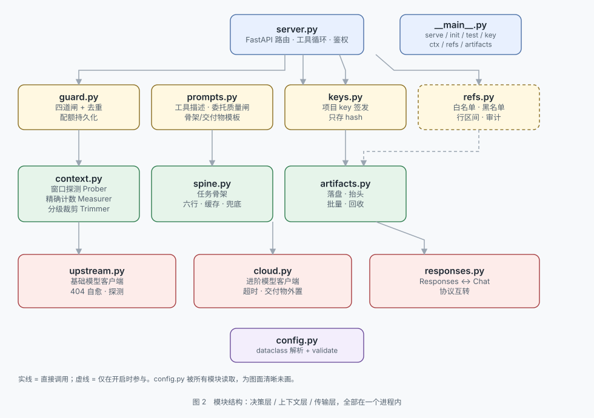

# steward

> 项目总览（是什么、为什么、三张图、快速开始）见仓库根目录的 [`README.md`](../README.md)。
> 本文是实现手册：每个模块怎么工作、每个参数什么含义、出问题怎么查。

本地模型的**管家**：背面两个模型槽位，正面只吐一把自己的 key。它管账（花不花得起）、管窗（装不装得下）、管档案（存不存得住）。

```
智能体 ──[项目 key]──> steward ──[基础模型]──> llama.cpp / LM Studio / vLLM / Ollama
                          │
                          └──[进阶模型]──> 云端 API（按次计费）
```

智能体只知道 `http://127.0.0.1:27418/v1` 和一把 `st-` 开头的 key。用哪个模型、什么时候花钱，全在网关内部决定。

顺带补上本地部署的两块短板：**窗口**（探真实窗口 + 精确计数 + 分级裁剪 + 溢出自愈）和**回灌**（大交付物落盘，只把摘要和路径塞进上下文）。还有一条可选的双向通道：让进阶模型直接读本地文件（见 <a href="#让云端读本地文件refs">refs</a>，默认关闭）。

## 两个模型槽位

| 槽位 | 定位 | 常见填法 | 成本 |
|---|---|---|---|
| **基础模型** | 日常主力，绝大多数请求由它完成 | 局域网里的 27B / 30B | 免费（自己的算力） |
| **进阶模型** | 只在复杂任务时被调用，受配额硬限制 | 云端大模型 API | 按次计费 |

槽位不绑定"本地/云端" —— 两个都可以是任意 OpenAI 兼容端点。你可以把基础模型也填成便宜的云端模型，规则照样成立。命名只表示**分工**。

两个槽位各自需要三样东西：`HTTP 地址` + `模型标识` + `API key`。

**进阶槽位可以空着。** 这不是容错，是设计：只有一台本地模型的人占多数。空槽位时网关不注入 `consult_cloud`，模型看不到这个工具，也就不会去调它；顺带每轮省下约 500 tokens 的工具定义（工具定义是常驻开销，不是按次）。判空只看 `base_url` 和 `model` 两项，填了一半按空处理。

```bash
python -m steward serve --check -c config.yaml   # 会明说进阶=空槽位
curl -s localhost:27418/health | grep configured  # "configured": false
```

基础槽位不能空——没有它网关一个模型都没有，`validate()` 直接拒绝启动。

> **基础模型的 key 是正经字段，不是摆设。** 本地服务不校验时可以留空，但字段要保留：一旦这台模型在局域网里给多台设备用，这个 key 就是唯一的门外锁；llama.cpp 的 `--api-key`、LM Studio、vLLM 的 `--api-key`、以及任何加在模型前面的反代（Nginx / Caddy）都会验它。网关在 key 非空时发 `Authorization: Bearer <key>`，为空就不发。

## 端口

默认 **27418**，可以用 `server.port` 或 `--port` 改。选值有三条硬规矩：不用 80/443/8080 这类常见端口、不用 12345 这种连续数字、落在 1024–49151（低于 1024 要 root，高于 49151 是 Windows 临时端口段）。

```bash
python -m steward serve --port 27418
```

配了不合适的端口不会拦你，但会提醒（`warnings()`，不是 `validate()`）。真撞上了会先自己试绑一次，报出占用的 PID，而不是丢一句 uvicorn 的 `WinError 10048`：

```
[端口] 127.0.0.1:27418 已被占用（PID 13028，tasklist /FI "PID eq 13028" 可查进程名）。
```

## 本地部署不止 Ollama

只要说 OpenAI 兼容协议就能接。常见几种的差异：

| 部署方式 | `model` 填什么 | key | 备注 |
|---|---|---|---|
| **llama.cpp** | GGUF 路径，如 `/models/x.gguf` | `--api-key` 启动则必填 | 支持 `/v1/chat/completions` 和 `/v1/responses` |
| **LM Studio** | 模型名（`/v1/models` 里能看到） | 要求非空，随便填 | 默认 `:1234` |
| **vLLM** | 模型名 | `--api-key` 启动则必填 | 支持 `reasoning_parser` |
| **Ollama** | 模型名，如 `qwen3:30b` | 不校验，可留空 | 默认 `:11434` |
| **Open WebUI / 反代** | 透传下游模型名 | 通常是必须的 | 用 `extra_headers` 加自定义头 |

网关会自己探测上游：`python -m steward test` 会打出上游类型、上下文长度、槽位数和模型数（llama.cpp 读 `/props`，其他服务读 `/v1/models`）。

## 两种协议

`base.protocol` / `advanced.protocol` 可选 `chat`（默认）或 `responses`。

- `chat` → `/v1/chat/completions`，通用
- `responses` → `/v1/responses`，OpenAI Responses 协议；新版 llama.cpp、vLLM 也支持

网关对外始终是 chat/completions，协议差异只在它和上游之间翻译。实测同一个 llama.cpp 端点两种协议都能跑通工具循环。

## 三把钥匙

| 钥匙 | 谁生成 | 谁持有 | 存哪儿 |
|---|---|---|---|
| 基础模型 key | 你的模型服务 / 反代 | 只网关知道 | `.env` 的 `BASE_API_KEY`（可空） |
| 进阶模型 key | 你买的云 API | 只网关知道 | `.env` 的 `ADVANCED_API_KEY` |
| **项目 key** | **本项目** | 智能体 | `state/keys.json` 里只存 sha256，**不存明文** |

项目 key 只显示一次。丢了就重新签一把，没有"找回"这回事 —— 因为服务端也没存明文。

## 三步跑起来

```bash
# 1. 装依赖
python -m pip install -r requirements.txt

# 2. 初始化：先配基础模型，再配进阶模型，最后签发项目 key
python -m steward init

# 3. 启动
python -m steward serve
```

`init` 会依次问：基础模型的地址/模型/key → 进阶模型的地址/模型/key/每日上限 → **自动探测该用哪种协议** → 写 `config.yaml` → 上游 key 写进同目录 `.env` → 签发项目 key 并打印。**那串 `st-...` 只出现这一次。**

智能体里这样填：

```
base_url = http://127.0.0.1:27418/v1
api_key  = st-xxxxxxxx-...
model    = auto
```

不管接 Claude Code、Cline、Continue、opencode 还是自己写的脚本，都是这三行。`model` 填什么都可以，网关不按它路由。

## Web 控制台

`/v1/*` 之外的同一端口上挂着一套界面：浏览器打开 `http://127.0.0.1:27418/`。

```
GET  /                       控制台页面（单文件，无外部依赖）
POST /console/api/login      口令 → 会话 cookie
GET  /console/api/state      当前配置（密钥只报告有无）+ 警告 + key 摘要
POST /console/api/save       改配置：YAML 按行改、密钥进 .env、写前校验
POST /console/api/test       拿未保存的值探一次上游 /v1/models
GET  /console/api/keys       项目 key 列表
POST /console/api/keys/new   签发（明文只返回一次）
POST /console/api/keys/revoke 吊销
```

三个实现要点，改这个模块之前先看一眼：

**按行改值，不整份重写。** `config.yaml` 是带注释的说明书，重写等于把它变成机器产物。`set_in_text()` 只替换 `section.key` 那一行的值，缩进、空行、顺序、行尾注释都留着。找不到目标键就原样返回 —— 调用方靠「写盘前校验」发现没生效。

**密钥只进 `.env`。** 界面上那个密码框留空表示「不改」，清空要用 `__CLEAR__` 标记。这是为了防止每次保存都把已有 key 抹掉 —— 空串当"清空"是最容易犯的错。

**写盘前跑一遍 `validate()`。** 候选文本先解析成 `AppCfg` 再校验，不通过就不落盘。用的是启动路径同一个函数（`config_from_dict`），不然会出现界面验证通过、启动时却不认。

会话与口令：`state/console.token`，首次启动生成，跨重启不变；cookie 是 `hmac(token)`，`HttpOnly` + `SameSite=Strict`；写操作再校验 `Origin` 同源。只靠 cookie 不够 —— 跨站表单 POST 不会带 `Origin` 之外的任何门槛，而浏览器允许它发生。

保存后要重启才生效。不做进程内重启的原因是端口：旧进程还握着 27418，新进程起来会和它抢同一个 socket。

## 局域网给多台设备用

```yaml
server:
  host: 0.0.0.0        # 对外监听
auth:
  mode: required       # 这条会被强制：非回环地址 + off = 拒绝启动
```

```bash
python -m steward key new --label 客厅主机
python -m steward key new --label 笔记本
```

每台设备一把 key，配额按 key 归因，吊销单个设备不影响其他设备。启动时会打印本机所有局域网地址。

## 自检

```bash
python -m steward test          # 探测两个槽位（只读，不花钱）
python -m steward test --all    # 再各发一次真实请求（进阶槽位会产生 1 次调用）
```

```
基础模型   /models/your-model.gguf
           调用 OK 1470ms
           探测 protocol=chat · 上游=llamacpp · 上下文=131072 · 槽位=1 · 模型数=1
进阶模型   https://api.example.com/v1 ...
```

模型列表探测是免费的，所以进阶槽位默认也会探 —— 地址填错、key 过期，这一步就能看出来，不用等接上智能体才发现。

## key 管理

```bash
python -m steward key list                 # 看所有 key、调用次数、最后使用
python -m steward key new --label cline    # 给另一个智能体单独签一把
python -m steward key revoke <id>          # 吊销，立刻失效
```

**一个智能体一把 key**，别共用。这样某个 agent 失控烧配额时，你能从 `/admin/usage` 的 `key` 字段直接定位到是谁，吊销它也干净。

## 流程

```
客户端 → 注入规则 + consult_cloud 工具 → 基础模型
                                      ↓ 模型自己决定调用
                                   护栏判定 → 进阶模型
                                      ↓ 交付物 role=tool 回灌
                                   基础模型继续 → 返回
```

模型调 `consult_cloud` 时，网关拦下这个 tool_call，不交给客户端；自己调进阶模型，把四段式交付物塞回对话，再让基础模型接着干。

工具名仍叫 `consult_cloud`（历史命名），指的就是"问进阶模型"。

## 上下文治理：本地窗口才是硬瓶颈

云端动辄 1M 上下文，本地 64K / 128K / 256K 且各家不一。长任务跑到几十轮，历史自然超过本地窗口。**这时上游多半不报错，它静默截断：**

| 上游 | 装不下时 | 客户端怎么知道 |
|---|---|---|
| llama.cpp（`n_keep=0`） | `--context-shift` 从位置 0 开始丢 | 不知道，HTTP 200 |
| llama.cpp（无 shift） | 400 `exceed_context_size_error` | 知道，但整轮工具循环已经白做 |
| Ollama | 从头部截断，只在服务端日志记一笔 | 不知道，HTTP 200 |

`n_keep=0` 意味着**最先死的是 system prompt 和工具定义** —— 模型突然不认识 `consult_cloud` 了，看着像"模型变笨"，其实是规则被截掉了。

网关做四件事：探真实窗口 → 精确计数 → 分级裁剪 → 溢出自愈。

### 探真实窗口

`n_ctx` 不等于能用的窗口：`--parallel 4` 会把它切成四份。网关按 `/props` → `/v1/models` → `/api/v0/models` → 配置 → 32768 的顺序探，拿到**每槽**窗口：

```bash
python -m steward ctx
```

```
基础模型  /models/your-model.gguf
  真实窗口    131072 tokens（来源 props，槽位 1）
  训练长度    262144
  可用窗口    111411（usable_ratio 0.85）
  输入预算    106803（已扣输出预留 4096 与安全余量）
  裁剪目标    69421（target_ratio 0.65）
  计数方式    /tokenize 精确计数
  估算系数    1.000   预算收缩 1.00
```

`usable_ratio` 的道理：长上下文的中段召回本来就弱（lost in the middle）。名义 128K 不代表 128K 都读得进去，按 85% 规划更稳。

### 精确计数

字符启发式在散文上误差约 15%，在**代码和 JSON 上低估 25%–40%** —— 而 agent 的上下文主体恰恰是这两样。实测 `"1234567890"` 是 10 个 token，数字一位一个。

所以优先调上游 `/tokenize` 直接数，32 万字 337ms。数不了才退回字符估算，并用每次响应的 `usage.prompt_tokens` 做 EWMA 自校准，比例存 `state/ctx.json`。

两者差额过大时判定为**静默截断**。这个信号只能靠对比得到，上游不会告诉你。

### 分级裁剪

超预算时按代价从低到高动手，每步做完重新量：

| 步骤 | 动什么 | 为什么先动它 |
|---|---|---|
| 1 | 历史的 `reasoning_content` | 思维链只在当轮有用，跨轮纯浪费 |
| 2 | 图片 | 一张图抵 1200 tokens |
| 3 | 旧工具输出 → 头 40 行 + 尾 40 行 + 错误/位置行，全文落盘 | 原始日志的边际价值随轮次衰减 |
| 4 | 合并同类工具结果 | 多次 grep 可以并成一条 |
| 5 | 整组丢最早的 tool_call + tool 结果 | **必须成对丢**，否则 `tool_call_id` 悬空，上游直接 400 |
| 6 | 硬截断 | 只在 force 时走 |

三条约束：

- **保护头尾。** 前 3 条 system、**第一条 user**、最后 `keep_recent` 条、最后一条 user 消息不动。
  第一条 user 就是任务目标本身；不保护它的话，硬截断会从头部把目标整句删掉，
  模型只能从后面某段测试日志里反推自己要干什么（这个缺陷实测复现过）。
- **不留悬空的 tool 消息。** 硬截断按位置删，可能删掉带 `tool_calls` 的 assistant
  却留下它的 tool 结果。llama.cpp 能忍，vLLM / 严格 Qwen 模板直接 400，
  所以最后有一道结构修复：删掉没有主人的 tool，摘掉等不到结果的 `tool_calls`。
- **不原地改调用方的列表。** 每次返回新列表，传进来的 `messages` 一个字节不改。
- **够用就一字节不动。** 没超预算直接返回原列表 —— 和 KV 前缀缓存直接相关，见下。

裁完之后往第一条 system 里塞一句标记，告诉模型中间被压缩过。不说的话模型会对着断裂的上下文编。

### 为什么不每次请求都裁

改历史中段会让 llama.cpp 的**前缀缓存整体失效**，从改动点开始重算。实测 prefill 1305 tok/s，在 30% 位置改一刀、后面 7 万 token 要重算 54 秒。

所以策略是"少裁、但裁到位"：触发线 0.85，一次砍到 0.65，且一次至少清 `min_clear_tokens`（8000）—— 为省 2000 token 让缓存全废是亏的。和 Anthropic 的 `clear_at_least` 是同一个思路。

### 溢出自愈

上游真报装不下（400）时不抛给客户端：紧急裁剪到「刚才那份实际没装下的 40%」，记住教训（`budget_scale` × 0.85），重试一次。省下的是整轮工具循环。

### 裁剪必须发生在工具循环内部

这是原来实现的真实缺陷：只在请求入口判一次预算，但交付物和工具结果是在**循环中途**长出来的。第 4 轮顶上来的 3 万字交付物，入口那次判断根本看不见。现在每一轮发请求前都过一遍。

### 任务骨架：压完还得记得住

裁到 10% 之后，模型手里只剩一句「前面有 226 条被压缩」。它知道有缺口，但不知道缺口里是什么，于是两种表现都很差：反复重试已经否决的方案，或者用「根据我们之前的讨论」凭空编。

`context.spine` 打开后，网关会把**被丢掉的那片区域**交给本地模型，提炼成六行留在 system 里：

```
[网关] 任务骨架（中间 332 条历史已压缩，以下是被保留下来的线索）
goal: 把这套服务的配额从按次改成按 token 计量，并补测试。
constraints: key 格式不能变
facts: prefill 实测 1305 tok/s；单槽 n_ctx=131072
rejected: Redis 计数（运维不批）
current: 已改完 guard.py，测试未跑
next: 补 test_guard.py 的计量用例
```

**最值钱的是 `rejected` 和 `facts`。** 前者丢了会重试一遍已知失败的路径，后者丢了会重新量一遍或改用猜测值。纯机械摘要产不出这两行 —— 得判断哪句是结论、哪句是过程 —— 所以这里真的要调一次模型。

成本与边界：

| 项 | 取值 | 为什么 |
|---|---|---|
| 什么时候触发 | 丢弃超过 `spine_min_dropped`（默认 4000 tokens） | 只丢几百 token 就调模型是浪费 |
| 一次请求几次 | **最多 1 次** | 裁剪多轮丢的是同一段旧历史，为几行几乎一样的字花 20 秒不值 |
| 实测耗时 | 7–13 秒（12000 字输入，输出 148–290 tokens） | 比预估的 19 秒快，prefill 快于经验值 |
| 缓存 | 按压缩区域 hash，`spine_state_file` | 客户端每轮重发同样的历史，命中就不花钱 |
| 超时/失败 | `spine_timeout_s`（默认 30 秒）后退回机械骨架 | 只保住 goal 和 current，绝不阻塞主请求 |

两个容易踩的点：

- **`goal` 必须来自用户原话，不能让模型自己写。** 首条 user 现在受保护、不在被丢弃的区域里，模型看不到它，就会把「最近在干什么」当成目标 —— 实测把「改配额计量」写成了「逐个阅读 mod_1 至 mod_43」。所以网关从裁剪后的消息里取第一句 user，既塞进提示词，也在事后强制覆盖。
- **区域要头尾各取一段。** 只取开头的话，`current` 会停在几百条消息之前。`render_region` 先给尾部留 60% 预算，剩下的给头部。

骨架用 `<<<SPINE … SPINE>>>` 标记块挂在第一条 system 里，重复触发时**原地替换**而不是追加 —— 否则一轮涨一块，很快又回到要裁剪的状态。

## 交付物外置

进阶模型输出按 16K 起算，回灌进本地 128K 的窗口，一次吃掉 12%。同一轮问两次就没了。

超过 `artifacts.min_store_chars`（1500 字）的交付物**先落盘，再只回灌一份摘要**：

```
[交付物已存档] id=art_3f9a1c7e02  全文 48,213 字 / 约 31,540 tokens
路径: /home/me/proj/.steward/artifacts/20261103/t7/consult-3f9a1c7e02.md
目录:
  - 一、问题定位
  - 二、改法
  - 三、验证
摘要（开头部分）:
...
需要细节时直接读上面这个路径的文件，不要凭摘要猜。
```

约 500 tokens 换掉 31,540 tokens。关键在于**文件就在智能体自己的文件系统里** —— 它有读文件的工具，要细节时自己去翻，不必把全文塞进上下文。路径给绝对路径，因为相对路径的基准是网关进程的 cwd，和智能体的 cwd 只能碰巧一致，不一致时那个失败是静默的。

**摘要比原文还长时直接回原文**（短文档 + 长绝对路径就会这样）。存档的意义是省 token，不是走流程。

### 目录与格式

落盘结构刻意做得可扫、可清：

```
<artifacts.dir>/
  20261103/
    consult/       b80db43370.md      交付物全文
    tool-batch/    1f9ad348d6.log     一次裁剪的 112 条工具输出
  index.jsonl                         全量索引（有行数上限）
```

每个文件都有统一抬头，自描述：

```
---
kind: tool-batch
turn: trim
created: 2026-11-03T05:04:52
chars: 190964
parts: 112
---
===== part 1 =====
...
```

路径里**刻意不放轮次**：同一份内容在不同轮各存一份没有意义，轮次记在抬头里就够了。这样跨轮次同内容只落一个文件。

### 一次裁剪一个文件

原先每条工具输出单独落盘：一次 363 条消息的裁剪写出 **113 个文件**。目录难看，inode 也浪费。现在合成一个文件，回灌的指针带行锚点：

```
[.. 完整输出已存档：/…/tool-batch/1f9ad348d6.log#L120-340 ..]
```

智能体照样能只读那一段。实测：**113 个文件 → 2 个**（一个批次 + 一个 index），总体积不变（233 KB）。

### 回收：不设上限就会一直涨

存档是只增不减的东西。两个上限取先到者，`0` 表示停用该项：

| 配置 | 默认 | 说明 |
|---|---|---|
| `max_age_days` | 30 | 按**目录名里的日期**清，不按 mtime |
| `max_total_mb` | 512 | 超了从最旧的日目录开始删 |
| `clean_interval_s` | 600 | 两次清理至少隔这么久，避免每次写都扫盘 |
| `index_max_lines` | 5000 | `index.jsonl` 的保留行数 |

用目录名而不是 mtime，是因为 mtime 是「最后一次写入」：一个天天在追加的旧目录会永远显得很新，永远删不掉。

```bash
python -m steward artifacts              # 看每天占多少
python -m steward artifacts --clean --dry-run   # 看会删什么
python -m steward artifacts --clean      # 真删
```

回收在启动和每次写入后自动跑（受 `clean_interval_s` 节流），CLI 只是手动入口。

## 让云端读本地文件（refs）

交付物是"出"，refs 是"进"。

委托单是人写的转述，说"我在 refresh_token 里加了锁但并发还是漏"，进阶模型只能猜。让它读那 80 行源码，结论就是确定的。**20 个字符的引用换来 12K 真实源码**，而且这份源码只进云端那 1M 的窗口，一分都不占本地。

实测（真网关 + 真 27B + 真文件）：

```
refs 展开 turn=t1793650888-1 文件=1 字数=13610
进阶模型返回 turn=t1793650888-1 kind=review 19631ms tokens=4404/756

X-Steward-Ctx: used=1962 budget=106803     ← 本地只花了 1,962
```

进阶模型拿到 4,404 tokens 的真实源码，本地上下文只占 1,962。这就是这条通道存在的全部理由。

模型调用时长这样：

```json
{"kind": "diagnosis", "ask": "并发刷新为什么会漏", "brief": "goal: ...",
 "refs": [{"path": "src/auth/session.py", "range": "40-120"},
          {"path": "src/auth/session.py", "grep": "def refresh_token"}]}
```

`refs` 是数组，每个元素四选一：`path` 整文件、`path`+`range` 行区间、`path`+`grep` 关键字附近、`glob` 批量。行号会保留，云端给的补丁才能落到具体行上。

### 这是唯一会主动往外发的通道

所以边界条件全部写死在网关里，模型改不了：

| 约束 | 行为 |
|---|---|
| `refs.enabled` | 默认 **false**。开了但没配 `roots`，启动时直接拒绝 |
| `roots` 白名单 | `resolve()` 之后必须落在白名单内 |
| 符号链接 | `resolve()` 会先展平再判白名单，指向外面的链接一样被拒 |
| 黑名单 | `.env` / `*.pem` / `*.key` / `id_rsa*` / `*credential*` / `*secret*` / `.git/*` 等 25 条 |
| 二进制 | 首 8KB 含 NUL 直接拒 |
| 限额 | 单文件 64KB、单次合计 12 万字符、最多 20 个文件 |
| 审计 | 每次展开写 `state/refs.jsonl`：哪一轮、读了哪些文件、拒了哪些 |

符号链接这一条值得单独说：只在字符串上判"路径里有没有 `..`"是不够的，`link -> /etc/passwd` 看不出任何异常。**展平之后再判归属**才堵得住。

### 判决要能一句话问清楚

白名单这种东西，最怕"以为配了其实没生效"。所以有个专门的命令：

```bash
python -m steward refs src/auth/session.py .env /etc/passwd
```

```
  白名单  1 个根目录
          /home/me/proj
  黑名单  内置 25 条

  允许  src/auth/session.py
        → /home/me/proj/src/auth/session.py  15,543 字节
  拒绝  .env
        命中拒绝规则 .env: .env
  拒绝  /etc/passwd
        不在白名单内: /etc/passwd

  合计 3 个，拒绝 2 个
```

退出码非 0 表示有拒绝，可以直接放进 CI。

### 引用失败会说清楚

被拒的文件不会静默消失。回灌的 `role=tool` 消息前面会加一行：

```
[refs] 已附上 1 个文件共 3,842 字。未附：命中拒绝规则 .env: .env。
```

这一行不能省。模型以为给了 8 个文件、实际只进了 2 个，它会基于"进阶模型看过全部"这个错误前提继续干活 —— 那比完全没给更糟。

`glob` 命中超过 `max_files` 时同样会明说"只取了前 N 个"。

## 配额：四道闸

这是整套东西唯一重要的部分，**只作用在进阶槽位上**。

| 闸 | 参数 | 默认 | 拦什么 |
|---|---|---|---|
| 单请求 | `max_calls_per_turn` | 2 | 一次请求里反复问进阶模型 |
| 每日 | `daily_limit` | 5 | 一天总量烧穿 |
| 间隔 | `min_interval_s` | 30 | 抖动式连续调用 |
| 重复 | `dedupe` / `similarity` | 开 / 0.92 | 换个说法问同一个问题 |

**"一轮"指一次 `/v1/chat/completions` 请求内部的工具循环**，不是你说的"一次对话"。

这个区别很重要：agent 干一个任务可能发几十次请求，单请求上限挡不住总量。所以 `daily_limit` 才是最终防线，`max_calls_per_turn` 只负责挡住"一次请求里模型钻牛角尖"。

计数在**放行时**就 +1，不等返回，避免并发绕过。连接失败、上游 4xx（请求被直接拒绝、没消耗 token）会自动退回。配额写盘（`state/usage.json`），重启不清零。

**退还的覆盖面比"连接失败"更宽。** 只要 `advanced.consult` 抛出了任何非预期异常（响应结构畸形、存档失败、上游 usage 字段给了个 list……），网关也会退回配额并回灌一条说明，而不是让整请求 500。否则模型连"这次失败了"都不知道，只看到一个断掉的连接，而额度已经扣掉。这条路径有专门用例：`tests/test_reliability.py`。

三道保证都有测试盯着：并发 10 个请求抢 3 个额度恰好只过 3 个（锁是有效的）、跨天自动归零、重启不清零。

### 配额之前还有一道质量闸

四道闸管的是「够不够用」，管不了「值不值得」。一份烂 brief 换来一份错方案，比不调用更糟 —— 模型会把错方案当真执行，而这次额度已经花掉了。

所以 `consult_cloud` 在进配额闸之前先过一遍检查，不通过就退回让模型补，**不计数、不花钱**：

| 退回条件 | 为什么 |
|---|---|
| `ask` 为空或超过 400 字 | 一次问多个问题，答案会全是浅的 |
| 用了五行格式但 `goal` 为空 | 专家不知道你要干什么 |
| `diagnosis` / `review` 的 `tried` 为空或写着 none | 没有实际执行记录，专家只能猜 |
| 完全没按格式写、内容又少于 40 字 | 九个字的委托单换不回有用的方案 |

尺度刻意放宽：**格式不规范但内容够的放行**。云端读散文也能干活，多退一轮纯属浪费本地时间。同一个请求最多退两次，第三次就放行 —— 否则模型会在原地打转，比错一次更糟。

### 让模型自己看着办

`remaining_today` 只在被拒的提示里出现太晚了 —— 那一轮已经浪费。所以每轮把配额写进 system：

```
[配额] 本轮最多 2 次，今日还剩 3 次（偏紧）。剩得少就把问题攒成一个更值钱的问，别拆成几次小的。
```

## 推理型模型：把 thinking 关掉

如果基础模型会输出 `reasoning_content`（Qwen3、DeepSeek-R1 这类），**一定要设** `base.thinking: "off"`。

实测（Qwen3.8-27B，400 token 预算，同一个需要外援的任务）：

| 设置 | 结果 |
|---|---|
| 默认（think on） | 1747 字思维链，预算耗尽，**0 次工具调用**，返回空 |
| `thinking: "off"` | 9 秒，**1 次工具调用**，不再空转 |

判断该不该花钱不需要长篇推理，那是进阶模型的活。网关关思考的方式是给上游发 `chat_template_kwargs: {"enable_thinking": false}`（llama.cpp / vLLM 认这个字段）。

## 被拦的时候发生什么

不报错。网关回一条 `role=tool` 消息：

> 本次请求内云端调用已达上限（2/2）。不要重试。基于已经拿到的交付物继续完成。

模型会照做，agent 不会崩。响应头能看到实际发生了什么：

```
X-Steward-Calls: 1       本次真正花了钱
X-Steward-Denied: 2      被拦了几次
X-Steward-Remaining: 4   今天还剩几次
X-Steward-Rounds: 3      基础模型循环了几轮
X-Steward-Ctx: used=68926 budget=106803 saved=90313   末轮实际发送 / 预算 / 省下多少
X-Steward-Truncated: 1   检测到上游静默截断（只在真发生时出现）
X-Steward-Refs: 3        本次随委托附上的本地文件数（只在 refs 真读了东西时出现）
```

## 参数

```yaml
base:                     # 基础模型
  base_url: http://127.0.0.1:8080/v1
  api_key: ${BASE_API_KEY:-}      # 可空，但别删这个字段
  model: /models/x.gguf
  protocol: chat                  # chat | responses
  thinking: "off"                 # auto | off | on
  timeout_s: 600
  min_max_tokens: 1024            # 客户端 max_tokens 太小时抬到这个值
  retry_404: true                 # 上游 keep-alive 出错时换短连接重试

advanced:                 # 进阶模型
  base_url: https://your-provider.example.com/v1
  api_key: ${ADVANCED_API_KEY}
  model: your-advanced-model
  protocol: chat
  thinking: auto                  # 云端强模型一般让它想
  timeout_s: 120
  max_tokens: 4096

context:                  # 本地窗口治理
  enabled: true
  ctx_limit: 0                    # 0=自动探测；探不到又知道实际值就显式写
  usable_ratio: 0.85              # 名义窗口里真正好用的比例
  target_ratio: 0.65              # 一次裁剪砍到预算的多少
  min_clear_tokens: 8000          # 一次至少清这么多，否则不值得让 KV 缓存失效
  reserve_output: true            # 输入预算里扣掉 base.max_tokens
  safety_tokens: 512
  strip_reasoning: true           # 历史思维链跨轮纯浪费
  strip_images: true
  tool_digest: true               # 旧工具输出压成头+尾+错误行，全文落盘
  tool_head_lines: 40
  tool_tail_lines: 40
  keep_recent: 4                  # 最近几条永不裁剪
  overflow_retry: true            # 上游报装不下时压缩后重试
  state_file: state/ctx.json      # 估算系数落盘，重启不丢
  spine: true                     # 裁剪后把丢掉的那片提炼成六行留在 system 里
  spine_min_dropped: 4000         # 丢得少于这么多 token 就不值得为它调模型
  spine_max_chars: 12000          # 喂给提炼模型的原文上限（头尾各取一段）
  spine_timeout_s: 30             # 超时就退回机械骨架，不阻塞主请求
  spine_max_tokens: 900
  spine_cache_size: 64            # 缓存多少份骨架（按压缩区域 hash）
  spine_state_file: state/spine.json

artifacts:                # 交付物外置
  enabled: true
  dir: .steward/artifacts     # 相对路径的基准是网关进程 cwd，不是智能体的
  inline_chars: 800               # 摘要里附带多少字原文
  min_store_chars: 1500           # 短于此不值得存档（摘要可能比原文还长）
  toc: true                       # 摘要里带标题目录
  absolute: true                  # 摘要里的路径给绝对路径；关掉才用相对路径
  max_age_days: 30                # 按目录名里的日期清；0 = 不按时间清
  max_total_mb: 512               # 超了从最旧的日目录开始删；0 = 不按容量清
  clean_interval_s: 600           # 两次清理至少隔这么久，避免每次写都扫盘
  index_max_lines: 5000           # index.jsonl 的保留行数
  batch_max_chars: 500000         # 一次裁剪的工具输出合并成一个文件的上限

refs:                     # 让进阶模型读本地文件（默认关闭）
  enabled: false                  # 打开前想清楚：这是唯一主动外发的通道
  roots: []                       # 白名单根目录，绝对路径。空着 + enabled 会拒绝启动
  max_file_bytes: 65536           # 单文件上限，超了读前缀并标注截断
  max_total_chars: 120000         # 一次委托所有引用合计上限，约 38K tokens
  max_files: 20
  grep_context: 3                 # grep 命中行上下各带几行
  deny: []                        # 空则用内置 25 条黑名单
  audit_file: state/refs.jsonl

auth:
  mode: required          # required | off
  keys_file: state/keys.json
  auto_issue: true

guard:
  max_calls_per_turn: 2   # 单请求上限，0 = 完全禁用进阶模型
  max_tool_rounds: 4      # 基础模型循环上限，超了强制收尾
  min_interval_s: 30
  daily_limit: 5          # -1 = 不限，不建议
  dedupe: true
  similarity: 0.92        # 0.92 ≈ 只改了几个词；调到 0.98 更宽松
  max_brief_chars: 6000   # 委托单截断
  max_result_chars: 16000 # 回灌截断，防上下文爆炸
```

改规则不用改代码：`prompt.system_text` / `prompt.tool_description` / `prompt.force_finish_text` 三处留空则用内置默认。工具描述里写的就是"什么时候该上云"的判据。

**提示词有 token 预算。** 每一轮固定注入 531 tokens（system 21 + 配额 12 + 工具定义 498），`tests/test_prompts.py` 里是硬断言：`test_injection_stays_within_budget` 卡总数 ≤560、`test_description_stays_lean` 卡描述 ≤240。改提示词时如果超了，测试会红——这是有意的，因为这套东西是包在智能体自己的提示词外面，每一分注入都是净增加。

三条「只说一遍」的约定也有断言守着：五行格式只在 `brief` 参数里出现、一次一问只在 `ask` 参数里出现、system 不复述工具定位。

旧配置里的 `local:` / `cloud:` 段仍能读，会自动当作 `base:` / `advanced:`。

## 管理端点

| 端点 | 用途 | 要 key |
|---|---|---|
| `GET /health` | 存活 + 今日配额 + 鉴权状态 + 窗口预算 | 否 |
| `GET /v1/models` | 客户端列模型（也是验 key 的地方），带 `context_length` | 是 |
| `GET /admin/context` | 窗口 / 预算 / 估算系数 / 上次裁剪 / 静默截断 / 骨架 / 存档占用 / refs 策略 | 是 |
| `POST /admin/context/probe` | 重新探一次上游窗口（改完 `--parallel` 不用重启） | 是 |
| `GET /admin/usage` | 完整用量、最近调用、每把 key 的调用数 | 是 |
| `POST /admin/reset-day` | 手动清零（调试用） | 是 |

`/v1/models` 会把真实窗口写成 `context_length`、输出上限写成 `max_output_tokens`。瞒着不说，行为良好的客户端会按它以为的窗口做压缩，两头对不上。

鉴权接受三种写法：`Authorization: Bearer <key>`、`X-API-Key`、`api-key`。

`server.api_key` 仍然可用，作为兼容旧配置的静态 key；新配置留空即可。

## 已知取舍

**内部非流式。** 首字延迟 = 整轮耗时（基础模型推理 + 可能的进阶往返）。换来的是不会出现"答案吐一半、突然冒出工具调用、重来一遍"。真要低延迟只能放弃服务端循环。

**客户端工具原样透传。** 编码 agent 自己传的 tools 会合并进去，只有 `consult_cloud` 被网关截走。模型同时调两类工具时，先执行咨询，再把剩下的 tool_call 返回给客户端。

**推理内容会一起带出去。** 基础模型返回的 `reasoning_content` 原样放进响应（流式也是一段 `delta.reasoning_content`），客户端认就显示，不认就忽略。

**进阶模型失败不重试。** 超时或 4xx 会把原因回灌给模型，让它用基础模型继续，不烧第二次钱。

**空回复会自动加预算重试一次。** 预算全被思维链吃掉时，`max_tokens` 翻倍重来；仍为空就把控制权交回模型，不让客户端拿到空白答案。

**裁剪要付前缀重算的代价。** 改历史中段 = llama.cpp 前缀缓存失效。所以是"少裁但裁到位"，不追求刚好卡在线上。反过来说，如果你的 prefill 很快（远高于实测的 1305 tok/s），可以把 `target_ratio` 调到 0.8 附近，裁得更细也更勤。

**静默截断只能事后发现。** 上游 200 返回、内容看着正常，只有 `prompt_tokens` 比估算值明显小才露馅。检测到之后网关会永久收缩预算（`budget_scale`），但那一轮已经丢了信息。

**refs 把"什么能出去"变成了配置项。** 打开之后，一个配错的 `roots` 等于开放整个目录树。网关能保证的是：只读不写、白名单内、黑名单外、有上限、有审计。它保证不了"你引用的那个文件本身不敏感"—— 那是你的判断。所以默认是关的。

**只做单轮对话内的循环。** 网关无状态，不记跨请求上下文；上下文由客户端维护 —— 所以窗口治理也是按单次请求算的，客户端如果自己就把历史撑爆了，网关只能在收进来的那一刻裁。

**骨架是摘要，不是备份。** 它留下的是目标、约束、已确认的事实、已否决的方案、当前位置。丢掉的细节（具体报错原文、某段代码）不会回来 —— 但那些多半已经落盘了，模型可以读回来。真正的风险是它**编造**缺失的部分，所以骨架末尾固定写一句「缺细节时用工具重新确认，不要凭记忆猜」。

**骨架让裁剪变慢。** 实测 7–13 秒（一次请求最多一次）。对一次本来就要 60 秒的长任务，这是 15% 左右的代价；对短任务，`spine_min_dropped` 会让它根本不触发。

**存档的回收是粗粒度的。** 按天删，不按文件删 —— 一个日目录里可能有几条你还想留的记录。要精确保留就先把文件挪出 `artifacts.dir`，或者把 `max_age_days` 设长一点，用 `max_total_mb` 兜底。

**存档内容不加密。** 落盘的是进阶模型的完整输出和工具原始输出，可能含源码片段、路径、业务信息。目录权限跟着网关进程的 umask 走。

## 排错

| 现象 | 原因 |
|---|---|
| 401 invalid api key | key 吊销了 / 复制少了字符 / 用的是模型 key 而不是 `st-` 项目 key |
| 基础模型连不上 | 服务没起 / 端口不对 / base_url 少了 `/v1` / key 不对 |
| 每隔一次就 502，日志说 404 | 上游 keep-alive 有缺陷（实测 llama.cpp 出现过 200/404/200/404）。`retry_404` 会自动切短连接，日志里有 `换短连接重试一次` |
| 复杂任务返回空 | 推理型模型没关 thinking，预算被思维链吃光。设 `thinking: "off"` |
| 一直不调用进阶模型 | 工具描述太保守 / 模型 tool calling 不稳 / 客户端 `tool_choice` 锁死了别的工具 |
| 每次都调进阶模型 | `tool_description` 写松了，收紧白名单 |
| 拦截次数偏高 | 模型在钻牛角尖。看 `/admin/usage` 的 `ask` 字段，通常是委托单写得太模糊 |
| 启动报 `server.host 是对外监听` | `host: 0.0.0.0` 配了 `auth.mode: off`，改回 `required` |
| 重启后额度还在 | 设计如此，删 `state/usage.json` 才清零 |
| 模型突然不调 `consult_cloud` 了 | system prompt 被上游静默截掉了。看 `/admin/context` 的 `truncated_seen`，或 `python -m steward ctx` 核对窗口是不是配大了 |
| 每轮开头卡几十秒才开始出字 | 裁剪触发了前缀缓存失效。调高 `min_clear_tokens`，或调低 `target_ratio` 让它一次裁得更狠、次数更少 |
| `/admin/context` 里 `source: default` | 没探到上游窗口，按 32768 保守处理。写 `context.ctx_limit` 显式指定 |
| 摘要里那个文件智能体说找不到 | `artifacts.dir` 写成绝对路径，别依赖相对基准 |
| refs 全被拒 | 先跑 `python -m steward refs <路径>` 看判决。最常见是 `roots` 用了相对路径被按配置目录展开 |
| refs 开了但模型不传 | 工具描述没提这件事。模型只会用 `description` 里写了的参数 |
| 担心发多了 | 看 `state/refs.jsonl`，每次展开都有记录；`X-Steward-Refs` 头是本次的数量 |
| 模型反复重试已经失败过的做法 | 骨架没开，或者 `spine_min_dropped` 设得太高。看 `/admin/context` 的 `spine.last_goal` 是不是空 |
| 骨架的 `goal` 写成了一段「最近在干什么」 | 这是旧版本的缺陷，现在 `goal` 强制取用户原话。若仍出现，检查首条 user 是不是被客户端改写成了别的角色 |
| 每次裁剪都等 7 秒 | 骨架模型调用。`spine: false` 关掉，或调大 `spine_min_dropped`。日志里有 `生成骨架 … 本请求第 N 次`，正常应恒为 1 |
| 存档目录越来越大 | `python -m steward artifacts` 看每天的量；`--clean --dry-run` 预演回收。也可能是 `max_age_days: 0` 把时间维度的清理关了 |
| 存档里的工具输出找不全 | 一次裁剪合并成一个文件，指针带 `#L120-340` 行锚点。`grep "===== part"` 可以列出该批次的所有段落 |

## 测试

```bash
python -m pytest tests -q            # 283 个：护栏 + 端到端 + 密钥 + 配置 + 协议互转 + 404 自愈 + 上下文治理 + refs + 骨架 + 存档 + 审计
python -m pytest tests/test_audit.py -s -q   # 只看对照表：同一份数据在修复前/后各跑一遍
python scripts/smoke.py              # 真实进程 + 真实鉴权
python scripts/demo.py               # 三进程联调，验证一次咨询的完整往返
python scripts/live_test.py          # 打真实本地模型（默认 127.0.0.1:8080）
python scripts/live_test.py --protocol responses
python scripts/ctx_live.py           # 量估算误差、验真实窗口、跑一次真裁剪
python scripts/ctx_live.py --stress  # 故意超窗，看上游是 400 还是静默截断
python scripts/ctx_live.py --fit 130000 --spine   # 真模型验一次骨架提炼
```

`ctx_live.py` 是唯一需要真实模型的上下文测试：`/tokenize` 到底支不支持、字符估算偏多少、裁剪完上游回来的 `prompt_tokens` 差多少，这三件事 mock 测不出来。

refs 的测试有 41 个，其中 30 个是**拒绝路径**：`../..` 逃逸、绝对路径越界、符号链接指向白名单外、`.env`、`.pem`、二进制、目录、超限截断。这个功能的安全性由拒绝率决定，不由功能数决定。

骨架的测试重点全在「退化了没有」：模型不按格式输出、超时、返回聊天、缓存失效时，是退到机械骨架还是干脆没有。这层失败不报错，只表现为模型开始重复已经否决的方案。

### 审计测试：对照的是代码，不是记忆

`tests/test_audit.py` 把**修复前的代码原样搬进来**当对照组（`LegacyTrimmer` / `LegacyStore` / `legacy_precheck`），同一份数据跑两遍，逐项比结果。这样结论可复核：差异是修复带来的，不是测试构造出来的。

| 组 | 案例 | 旧 | 新 |
|---|---|---|---|
| 委托质量闸 | 9 种不同形态的委托单 | 全放行 | 拦下 5 个不可判的，4 个合格的照常通过 |
| 目标保护 | 工具对密集 / 纯文本 / 尾部窗口切割 / 多模态 | 后三种丢目标 | 全部保住 |
| 结构合法 | 同上 | 尾部切割产生 1 个悬空 tool | 零孤儿 |
| 骨架 A/B | 同一份含「否决 Redis」的历史 | 决策丢失 | 经 `rejected` 行回来 |
| 存档 | 60 条工具输出 / 跨轮重复 / 超龄目录 | 60 文件、3 份、永不回收 | 1 文件、1 份、按策略清 |

每组都有一条 `*_no_regression`：**没变的场景必须确实没变**。工具对密集时新旧输出逐条相同，证明修复是精准的，不是到处改。

还有三条元验证（`test_audit_meta_*`）：把旧实现喂给审计判定，必须判它不合格。否则这套审计就是"写了但测不出"——那比没有更危险，因为它会给人已经验证过的错觉。

`state/big_history.json` 在的时候还会拿 363 条真实消息跑一遍：

```
实现  裁剪前  裁剪后  硬截  目标在  消息数
旧    109535  17801   67    否      72
新    109535  17822   66    是      73
```

新实现只多 21 tokens、多 1 条消息——正好是被保住的那句目标。

## 结构



```
steward/
  config.py     配置解析（base/advanced 两个槽位，兼容 local/cloud）
  keys.py       项目 key 签发与校验（只存 hash）
  prompts.py    注入文本 + 工具定义 + 委托质量闸
  guard.py      配额与去重（核心）
  cloud.py      进阶模型客户端
  upstream.py   基础模型客户端（含 404 自愈、上游探测）
  context.py    窗口探测 / 精确计数 / 分级裁剪 / 结构修复（P0）
  artifacts.py  交付物落盘、批量存档、按天回收（P1）
  refs.py       本地文件引用的白名单、黑名单与审计（P2）
  spine.py      任务骨架：从被压缩的区域提炼六行（P3）
  responses.py  Responses ↔ Chat 协议互转
  server.py     FastAPI 路由、鉴权与工具循环
  __main__.py   serve / init / test / key / ctx / refs / artifacts
```
